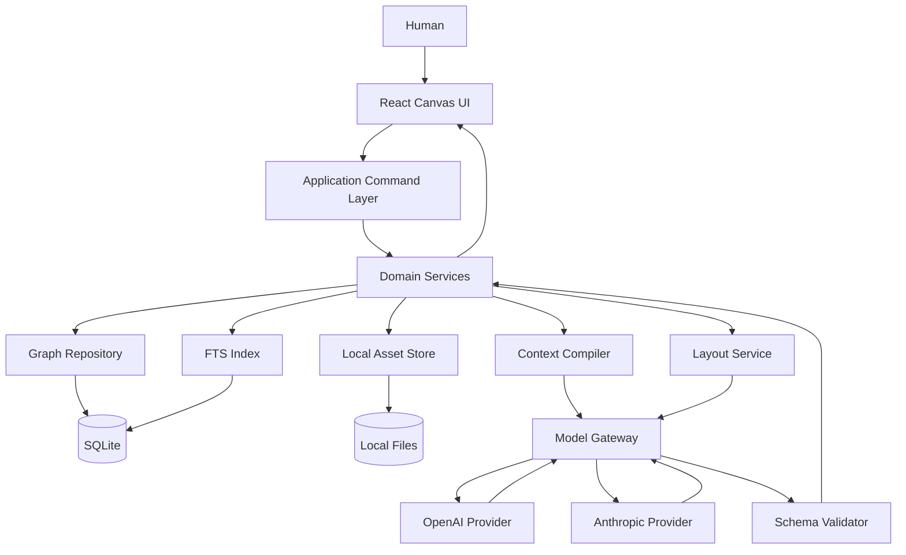
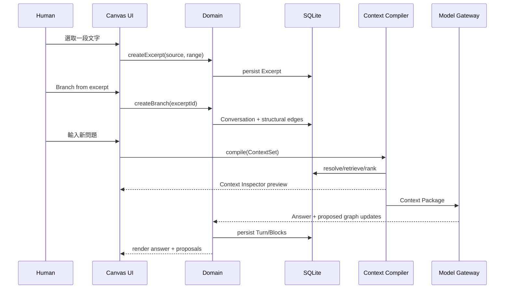

## 系統架構、Agent 分工與技術選型
### 系統架構

建議從 local-first modular monolith 開始，不要在 MVP 建 microservices。



一次「由節選建立 branch 並問 AI」的流程：



### Agent 分工

第一版的「Agent」更準確地說是 **role-specific workflows**。

Anthropic 將 workflow 定義為由程式碼預先決定執行路徑，而 agent 則讓模型動態控制自己的流程與工具；其官方工程文章建議先用最簡單可行方案，並指出 workflow 在明確任務上具有較高可預測性。

因此建議：

```text
One underlying model
        │
        ├── Context Manager prompt
        ├── Layout Planner prompt
        ├── Semantic Linker prompt
        ├── Summarizer prompt
        └── Answer Generator prompt
```

而不是：

```text
5 autonomous agents
   ↕
互相聊天
   ↕
自行修改 DB
```

模型輸出必須使用 JSON Schema / structured output。OpenAI Structured Outputs 官方文件明確支援依 supplied JSON Schema 約束輸出；Anthropic 亦提供 structured outputs，但兩家的 schema constraints 並不完全相同，因此 domain schema 應由本地 validator 再驗一次。

| Role | 主要責任 | Input | Output | 可直接修改 Graph？ |
|---|---|---|---|---:|
| Context Manager | 對 ambiguous candidates 做 relevance/conflict 輔助判斷 | query + candidate metadata | context decisions | 否 |
| Layout Planner | 決定 cluster / visual intent | graph summary + bounds | `LayoutIntent[]` | 否 |
| Semantic Linker | 提出語義關聯 | nodes/content | proposed edges | 否 |
| Summarizer | 壓縮 branch / node | source blocks | sourced summary | 否 |
| Answer Generator | 產生使用者答案 | Context Package | answer + graph proposals | 只能 proposal |

**Context Manager system prompt 範例**

```text
You are the Context Manager for AI Context Canvas.

Your job is NOT to answer the user's question.
Your job is to evaluate candidate context items for relevance.

Rules:
1. Preserve all provided source IDs exactly.
2. Never invent a node, excerpt, source, relation, or state.
3. Explicitly selected and pinned items are controlled by application policy,
   not by you.
4. Treat rejected and superseded content as historical unless the query
   explicitly asks about history.
5. Identify potential contradictions only when evidence exists.
6. Do not rewrite source facts.
7. Return only the requested structured output.

For every candidate, return:
- source_id
- semantic_relevance: 0..1
- reason
- potential_conflict_ids[]
```

I/O：

```json
{
  "input": {
    "query": "第一版要選 SQLite 還是 Neo4j？",
    "candidates": [
      {
        "source_id": "node_a",
        "state": "superseded",
        "text": "第一版用 Neo4j"
      },
      {
        "source_id": "node_b",
        "state": "confirmed",
        "text": "第一版改用 SQLite"
      }
    ]
  },
  "output": {
    "decisions": [
      {
        "source_id": "node_a",
        "semantic_relevance": 0.76,
        "reason": "與問題相關但屬歷史方案",
        "potential_conflict_ids": ["node_b"]
      },
      {
        "source_id": "node_b",
        "semantic_relevance": 0.99,
        "reason": "目前確認方案",
        "potential_conflict_ids": ["node_a"]
      }
    ]
  }
}
```

**Layout Planner system prompt 範例**

```text
You are the Layout Planner for AI Context Canvas.

You propose layout intentions. You do not move nodes directly.

Goals:
- improve readability,
- reveal conversation branching,
- preserve the user's spatial memory,
- minimize unnecessary movement.

Hard rules:
1. Never propose moving pinned nodes.
2. Preserve user-created clusters unless a clear conflict exists.
3. Prefer local changes over whole-canvas rearrangement.
4. Return semantic grouping intent, not pixel-perfect free-form artwork.
5. Every operation needs a reason and confidence.
6. In Assist mode every change requires preview/acceptance.

Return LayoutIntent JSON only.
```

Input：

```json
{
  "mode": "assist",
  "viewport": {
    "x": 900,
    "y": 400,
    "width": 1400,
    "height": 900
  },
  "nodes": [
    {
      "id": "a",
      "title": "Context Engine",
      "pinned": true
    },
    {
      "id": "b",
      "title": "Context Inspector",
      "pinned": false
    }
  ],
  "edges": [
    {
      "source": "a",
      "target": "b",
      "type": "elaborates"
    }
  ]
}
```

Output：

```json
{
  "intents": [
    {
      "type": "cluster",
      "node_ids": ["a", "b"],
      "label": "Context Architecture",
      "reason": "兩節點屬同一產品子系統",
      "confidence": 0.91,
      "requires_confirmation": true
    }
  ]
}
```

**Semantic Linker system prompt 範例**

```text
You are the Semantic Linker.

Find meaningful semantic relationships between supplied nodes.

Allowed relationship types:
supports, contradicts, elaborates, example_of,
depends_on, alternative_to, related_to, supersedes.

Rules:
1. Never create structural relationships such as reply_to or branch_from.
2. Do not infer a relation if evidence is weak.
3. Cite the exact source IDs used as evidence.
4. Confidence below 0.65 should normally return no proposal.
5. Every result is a proposal, never a confirmed fact.
6. Return JSON only.
```

Output：

```json
{
  "proposals": [
    {
      "source_node_id": "node_context_set",
      "target_node_id": "node_context_inspector",
      "type": "depends_on",
      "confidence": 0.88,
      "evidence_source_ids": [
        "block_11",
        "block_27"
      ],
      "reason": "Inspector 的顯示資料直接來源為 Context Set"
    }
  ]
}
```

**Summarizer system prompt 範例**

```text
You are the Summarizer.

Produce a compact faithful summary of the supplied source blocks.

The summary must distinguish:
- confirmed decisions,
- hypotheses,
- rejected ideas,
- unresolved questions.

Rules:
1. Do not add new claims.
2. Preserve source IDs for every important statement.
3. Never turn a hypothesis into a confirmed decision.
4. Preserve contradictions instead of silently resolving them.
5. Return JSON only.
```

Output：

```json
{
  "summary": "MVP 決定先使用 SQLite；Neo4j 方案已被取代。",
  "decisions": [
    {
      "text": "MVP 使用 SQLite",
      "source_ids": ["node_sqlite"]
    }
  ],
  "rejected_or_superseded": [
    {
      "text": "MVP 使用 Neo4j",
      "source_ids": ["node_neo4j"]
    }
  ],
  "open_questions": [],
  "source_ids": [
    "node_sqlite",
    "node_neo4j"
  ]
}
```

**Answer Generator system prompt 範例**

```text
You are the Answer Generator for AI Context Canvas.

Answer the user's current request using the supplied Context Package.

Rules:
1. Treat the Context Package as the authoritative application context.
2. Respect context state:
   confirmed > active > hypothesis > historical/superseded.
3. Never silently rely on an excluded source.
4. If context contains an unresolved conflict, surface the conflict.
5. Do not claim that you saw a node that is not in the package.
6. Return:
   - answer
   - used_source_ids
   - suggested_graph_updates
7. Suggested graph updates are proposals and must never mutate storage directly.
```

Output：

```json
{
  "answer": "第一版建議採 SQLite，因為目前確認的架構決策已將 Neo4j 標為 superseded。",
  "used_source_ids": [
    "node_sqlite",
    "node_neo4j"
  ],
  "suggested_graph_updates": [
    {
      "type": "summary_node",
      "reason": "此輪形成明確技術決策",
      "source_ids": [
        "node_sqlite",
        "node_neo4j"
      ]
    }
  ]
}
```

### 技術選型

| 層 | 建議 | 原因 |
|---|---|---|
| 語言 | TypeScript | frontend/backend/domain schema 共用 |
| Frontend | React + Vite | 快速 local app |
| Canvas | `@xyflow/react` / React Flow | node/edge interaction 基礎成熟；官方已有 layout、collapse、collaboration 等範例  |
| State | Zustand 或 equivalent | Canvas transient state 與 server/domain 分開 |
| API | Node.js + Fastify 類型的薄 API | 保持單一 TS stack |
| Validation | Zod + JSON Schema export | domain + LLM structured output 共用 |
| DB | SQLite | local-first、單人 MVP、低維運 |
| Search | SQLite FTS5 | 不先引入另一個 search service；支援 relevance ordering  |
| ORM | Drizzle 類型薄 ORM 或直接 SQL | schema migration 清楚 |
| Graph persistence | SQLite `nodes` / `edges` adjacency tables | MVP 不需要 Neo4j |
| Graph DB | **MVP 不採用** | 專用 graph infrastructure 暫無必要 |
| Layout geometry | ELK.js / deterministic layout engine | LLM 提 intent，演算法算 geometry；React Flow 官方已有 ELK/dagre 類 auto-layout 示例  |
| LLM API | Provider adapter | OpenAI / Anthropic 可替換 |
| OpenAI | Responses API | 官方推薦新專案採 Responses  |
| Structured output | provider native + local validation | OpenAI、Anthropic 均支援 structured output  |
| Assets | `data/assets/` + SHA-256 metadata | 簡單 local provenance |
| Test | Vitest + Playwright 類型組合 | unit + browser interaction |
| Deployment | localhost web app | MVP 最少 packaging complexity |
| Desktop | 未指定；Phase 2 可考慮 wrapper | 先驗證 UX 再決定 |

**為什麼 MVP 不用 Neo4j**

這裡的圖雖然是真 Graph，但「資料結構是 graph」不等於「第一天就必須用 graph database」。

MVP 主要 query 可以用：

```sql
nodes
edges
conversations
turns
content_blocks
excerpts
context_sets
```

搭配：

```text
direct neighbors
parent chain
branch origin
workspace filter
state filter
FTS result
```

即可完成。等到實際 profiler 顯示 traversal、cross-workspace graph analytics 或 graph pattern matching 成為主要瓶頸，再抽換 `GraphRepository` implementation。

推薦先定義：

```ts
interface GraphRepository {
  getNode(id: string): Promise<Node>;
  getEdges(nodeId: string): Promise<Edge[]>;
  getNeighbors(nodeId: string, options?: QueryOptions): Promise<Node[]>;
  getAncestors(nodeId: string, maxDepth: number): Promise<Node[]>;
  saveNode(node: Node): Promise<void>;
  saveEdge(edge: Edge): Promise<void>;
}
```

如此日後 SQLite → Neo4j 不需要改 Context Compiler contract。

---
