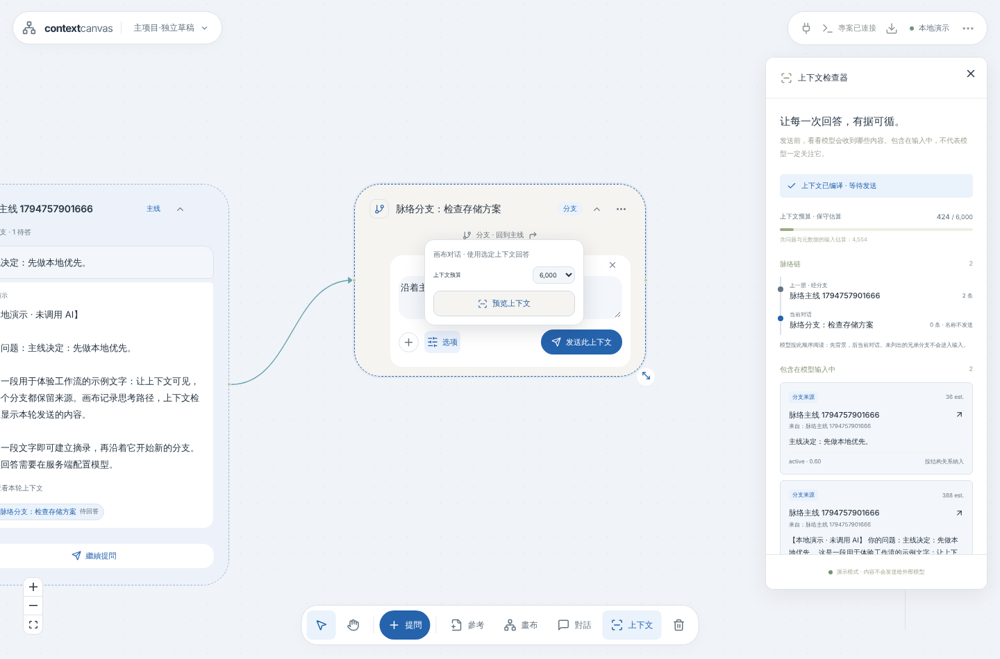

# 脉络链：让模型知道每段背景来自哪条对话（0.14.0）

分支、顺手问、摘录分支和汇合点会让一次提问的背景来自好几条对话。0.14.0 起，模型收到的不再只是一组平铺的片段，还会收到一条**脉络链**：哪些对话提供了背景、它们与当前对话是什么关系、应当按什么顺序阅读。

## 你会看到什么

预览上下文或查看历史回答的输入时，检查器在「包含在模型输入中」上方显示「脉络链」。只有一条对话参与时不显示。

| 标记                | 含义                                                       |
| ------------------- | ---------------------------------------------------------- |
| 上 N 层 · 经分支    | 当前对话通过「分支 /fork」从它延伸；上一层即直接来源       |
| 上 N 层 · 经顺手问  | 通过「顺手问 /btw」延伸                                    |
| 上 N 层 · 经摘录    | 当前对话从它的一段摘录开始                                 |
| 上 N 层 · 经汇合    | 当前对话从汇合点开始，这条对话贡献了其中的片段             |
| 汇合观点 / 参考来源 | 本轮选中或固定的汇合点、其他对话与参考文件，不在延伸路径上 |
| 当前对话            | 正在继续的这条对话，总是排在最后                           |

点击任一项回到画布上的对应卡片。每条来源卡片下方的「来自：…」标明它属于哪条对话。

## 模型如何使用

- 模型输入新增 `threads` 列表，每条来源带 `thread_id`。来源按链的顺序排列：最远的背景在前，当前对话在后；同一对话内按发言顺序。0.16.0 起问题放在所有背景之后，见[回答的设计原则](answer-behavior.md)。
- 指示模型沿链推理：继承上层已确定的内容；当前对话中较晚的决定优先于较早的背景；多条对话贡献观点时分别比较、明确归属，不混为一谈。
- 未列出的兄弟分支对模型不可见，模型也被告知这一点。

哪些内容进入输入、预算如何取舍与以前完全相同：选中、固定、排除、生命周期状态和预算规则都没有改变。脉络链只改变呈现顺序并补充关系说明。

## 边界

- 脉络链只由确定的结构推导：分支记录、分支来源摘录和汇合点成员。卡片位置、连线外观和模型输出都不参与。
- 只有当一条对话**自己的消息**进入输入时，才把它的名称发送给模型。只引用了片段的对话、从摘录开始的对话、含有已排除内容的对话，名称一律不发送（检查器标注「名称不发送」），因为名称可能重复未选中或已排除的文字。检查器仍显示你本机的名称，方便辨认。
- 被排除或删除的来源不会出现在链中，也不会以名称或 ID 的形式进入输入。
- 链的说明计入输入预算估算。
- 关系说明能帮助模型组织推理，但不保证模型一定按预期关注每条来源。

## 数据与兼容

不新增 SQL 表或迁移。Context Package 新增可选字段 `threads`，Context Item 新增可选字段 `thread_id`，随回答一起封存。0.14.0 之前保存的输入包没有这些字段，查看和重试时保持原来的序列化，不会被改写。含新字段的项目文件需要 0.14.0 或更新版本导入。
