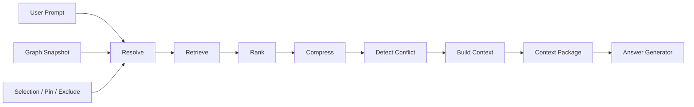

### Context Compiler
Context Compiler 是產品中最接近「compiler」而不是「chat history builder」的核心。



**輸入**

```ts
type ContextCompileInput = {
  workspaceId: string;
  conversationId?: string;
  currentNodeId?: string;
  prompt: string;

  selectedNodeIds: string[];
  pinnedNodeIds: string[];
  excludedNodeIds: string[];

  graphSnapshotVersion: string;
  tokenBudget: {
    maxInputTokens: number;
    reservedOutputTokens: number;
    targetContextTokens: number;
  };

  policyVersion: string;
};
```

**Resolve**

Resolve 不做「AI 判斷」，而是把 UI 操作解析成 canonical references。

例如：

```text
Canvas Node
   ↓
ref_id
   ↓
Excerpt
   ↓
source_block_id
   ↓
Turn
   ↓
Conversation
```

此階段應完成：

```text
node ID resolution
excerpt → source resolution
content hash verification
deleted/missing reference detection
context state lookup
structural ancestry resolution
explicit user override resolution
```

原則：

> 使用者明確 Pin / Select / Exclude 的操作優先於 AI 推斷。

**Retrieve**

MVP 建議使用混合但偏 deterministic 的 retrieval：

```text
Candidate Pool
├── explicit selected
├── pinned
├── current conversation ancestors
├── branch origin excerpt
├── direct structural neighbors
├── confirmed related nodes
└── SQLite FTS5 lexical results
```

FTS5 可在 SQLite 內完成 full-text query 與 relevance ordering，因此 MVP 不需要先部署另一個 vector database。

Phase 2 再加入：

```text
embedding retrieval
contextual chunk retrieval
reranking
cross-workspace retrieval
```

Anthropic 的 Contextual Retrieval 實驗指出，在傳統 chunk retrieval 之外加入 chunk-specific context，再搭配 BM25 / reranking，可以降低 retrieval failure；這可以作為未來 RAG 路線參考，而不是 MVP 的必要依賴。

**Rank**

推薦先採可解釋的 scoring，而不是直接問 LLM「哪些比較重要」。

範例：

```text
if explicitly_selected:
    score = 1.00
else if pinned:
    score >= 0.95
else:
    score =
      0.30 * structural_relevance +
      0.25 * semantic_relevance +
      0.15 * lexical_relevance +
      0.15 * state_score +
      0.10 * recency_score +
      0.05 * spatial_signal
```

實際權重是**未指定**，必須透過 eval fixture 調整；上式只是第一版可測 baseline。

另外應套用 hard rules：

```text
rejected       → exclude unless explicitly requested
superseded     → historical only
confirmed      → boost
selected       → always retain unless impossible
excluded       → never include
```

**Compress**

當 candidate 超出 budget 時，不應單純 truncate。

推薦層次：

```text
Raw pinned excerpt
        ↓ 不壓縮
Current prompt / selected content
        ↓ 優先保留原文
Direct source facts
        ↓ 優先保留
Low-priority historical discussion
        ↓ summary
Large old branches
        ↓ branch summary
Repeated context
        ↓ deduplicate
```

每個壓縮結果必須保留：

```text
summary_id
source_ids[]
source_content_hashes[]
summary_version
```

這一點是為了阻止 summary 逐代改寫造成 provenance drift。

**Detect Conflict**

先 deterministic，再 semantic。

```text
Stage A
explicit supersedes edge
rejected state
duplicate source
content version mismatch

Stage B
high-ranking facts
     ↓
LLM conflict classifier
     ↓
contradiction proposal
```

範例：

```json
{
  "a": "node_neo4j",
  "b": "node_sqlite",
  "type": "superseded_by",
  "resolution": "prefer_b",
  "reason": "node_sqlite is confirmed; node_neo4j is superseded",
  "status": "resolved"
}
```

**Build Context**

最終不是「把文字 concat 起來」，而是建立有語義區段的 Context Package：

```text
System instructions

Current goal
Current user prompt

Explicit context
├ selected
└ pinned

Active canonical context

Referenced context

Retrieved context

Historical context
└ clearly marked as historical/superseded

Conflict notes

Source map
```

這種有選擇地建 context 比「整串歷史無差別塞入」更符合產品目標；長上下文研究已顯示，相關資訊存在於長 prompt 中並不代表模型總能同等可靠地使用它。

**Context Package 範例**

```json
{
  "package_id": "pkg_042",
  "context_set_id": "ctx_042",
  "policy_version": "context-policy-0.1",
  "goal": "回答 Context Compiler 的排序設計問題",
  "current_prompt": "Context Compiler 應該怎麼排序 context？",
  "items": [
    {
      "source_id": "excerpt_012",
      "node_id": "node_excerpt_012",
      "role": "selected",
      "state": "active",
      "content": "Context 不應等於所有 ancestors。",
      "score": 1.0,
      "reason": "explicit user selection",
      "compressed": false
    },
    {
      "source_id": "node_product_principle",
      "node_id": "node_product_principle",
      "role": "pinned",
      "state": "confirmed",
      "content": "人與 AI 應共享同一套可視化 context map。",
      "score": 0.98,
      "reason": "workspace pinned product principle",
      "compressed": false
    },
    {
      "source_id": "summary_old_context",
      "node_id": "node_old_branch",
      "role": "retrieved",
      "state": "reference",
      "content": "早期方案使用 ancestor-only context，但已發現無法處理跨 branch relevance。",
      "score": 0.71,
      "reason": "historical comparison",
      "compressed": true
    }
  ],
  "conflicts": [
    {
      "a": "node_old_neo4j_plan",
      "b": "node_sqlite_plan",
      "type": "superseded_by",
      "resolution": "prefer_b",
      "status": "resolved"
    }
  ],
  "excluded": [
    {
      "source_id": "node_old_neo4j_plan",
      "reason": "explicitly excluded and superseded"
    }
  ],
  "budget": {
    "max_input_tokens": 64000,
    "target_context_tokens": 24000,
    "used_context_tokens": 8421,
    "reserved_output_tokens": 8000
  },
  "trace": {
    "resolved_candidates": 31,
    "retrieved_candidates": 18,
    "ranked_candidates": 18,
    "included_items": 9,
    "compressed_items": 2
  }
}
```

Context Inspector 應直接呈現此 package，而不是重新用另一套邏輯猜「AI 大概看了什麼」。

---
