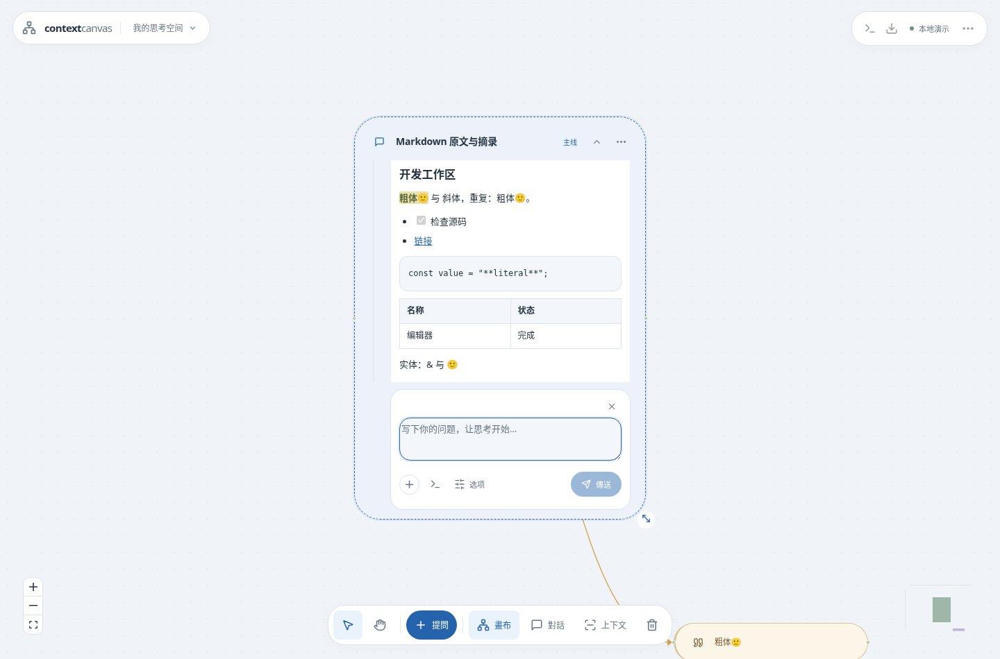

# 在 Synduck 中开发项目（0.8.0）

画布对话与本地 AI 任务是两个入口：

| 入口               | 可以做什么                                                                  |
| ------------------ | --------------------------------------------------------------------------- |
| 普通画布对话       | 根据选定的上下文讨论、回答、Pick 与分叉；不直接执行文件或终端工具           |
| 本地任务 → AI 任务 | 使用 ChatGPT / Codex 读取后端电脑的项目、提出文件修改与命令；操作在界面确认 |

在普通对话里说“授予权限”或贴 GitHub 链接，不会改变该回答的工具权限。Synduck 已有本地执行器，无需换到其他聊天产品来使用它；本地任务也不会自动创建云端工作区。

## 从当前问题转入开发

1. 点输入框下方的终端图标「交给本地任务」。有草稿时带入草稿；空白时使用这段对话最近一次用户提问。
2. 程序编译并检查该问题的画布上下文，打开本地任务并勾选附带上下文。预算不够或来源被排除而阻塞时，先打开上下文检查器处理，避免漏掉必需输入。
3. 填入后端电脑上已有的源码目录，勾选启用并保存。尚未克隆时，可以先选已有的父目录，再让任务执行克隆和依赖安装。需要本机已安装 Git、Node.js 24 和 pnpm，以及相应网络连接。
4. 在「模型与登录」完成 ChatGPT 登录并选择 Codex 模型，再点「开始 AI 任务」。交接本身不会自动执行，原画布草稿保持不变。
5. 在操作记录中确认具体写入、命令或工具调用，查看实际结果。任务结束可将记录加入画布提问，整理交接摘要。

设置和首次使用也见[安装指南](setup.md)与[执行器限制](local-runtime-updates.md)。本地任务目前仅使用已登录的 ChatGPT / Codex；Demo 或直接 API 模式的普通回答不能替代该连接。

## 开发 Synduck 自身

推荐使用安装好的稳定版界面，操作单独克隆的 `Yukayuyu/synduck` Git 源码目录。Windows ZIP 中主要是编译产物，开发需要完整源码。调试新版使用另一组端口，稳定版继续保留画布和本地任务连接。源码安装的开发服务器由你启动、停止；任务中避免重启承载当前任务的后端。

每个开发任务需要明确需求、验收条件和项目约束。先检查分支、版本和 `git status`，读取 `AGENTS.md`、`package.json` 与相关源码；重要规则直接写入任务或显式附加到画布上下文。仓库文档与本次聊天历史不会自动加载。这个项目默认在 `main` 工作，保留原文、出处和已封存输入包；不擅自引入多智能体或图数据库。结束时报告改动、检查结果及未完成事项。

一次只执行一个本地任务，每任务最多 20 个操作、15 分钟；命令默认 60 秒、最多 120 秒。读文件最多向模型返回 20 KB，超过 64 KB 的文件不能用内置整文件读写工具处理。较大的文件和检查需要按范围定位、通过确认后的命令处理，或分成多个任务。不要用截断的文件片段覆盖完整文件。MCP 与桌面工具仍遵循原有逐次确认和记录规则。

ChatGPT 登录授权模型，不等于 GitHub 推送授权。提交、推送和发布需要后端电脑自己的 Git 配置及凭证；安装与匿名更新仍不需要 GitHub token。

## Markdown 阅读与 Pick

AI 回答、生成中的文字、本地任务回复和追溯页支持标题、粗体、斜体、列表、任务列表、引用、链接、表格与代码块。用户输入和工具原始输出保持原文显示。HTML 作为文字显示，图片显示为可打开的链接。

格式化只改变阅读层。原始 Markdown、内容哈希与历史输入包保持不变。Pick 按原始 UTF-16 范围保存；选择跨越多种格式时，范围内的 Markdown 标记也会保留在摘录快照中。来源高亮与连接线使用同一组映射，不会把排版后的字符数量误当原文位置。卡片菜单的复制仍取得原文。

## 对话框大小与输入选项

打开对话后，拖动右下角手柄调整宽高。也可在卡片「⋯」或右键菜单选择「调整对话框尺寸」，输入数值，或恢复自动尺寸。手动宽度范围 340–1600，高度 360–1800；尺寸随画布保存、重启和单张备份保留，折叠不清除设置。

「选项」使用浮层，展开时不改变卡片大小或挤走发送按钮。点其他区域、再次点选项，或在菜单内按 Escape 可关闭；只有明确的键盘关闭会把焦点返回选项按钮。

本版新增可选节点字段 `size_mode`，复用现有宽高字段，无 SQL migration。旧画布继续自动排版；含该字段的 JSON 备份需要 0.8.0 或更新版本导入。
