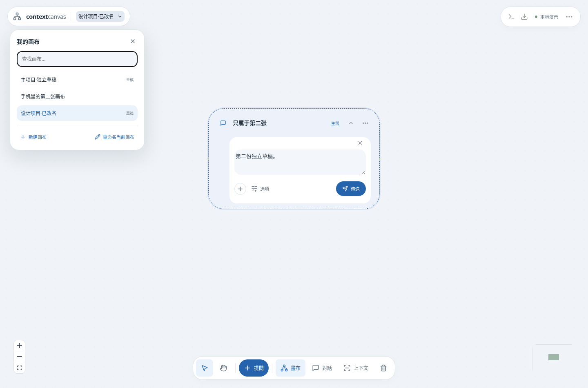

# 多画布（0.7.0）

## 新建与切换

点左上角画布名称打开列表，可查找、新建、切换或重命名。现有内容自动保留在第一张画布，无需重新导入。列表标记生成中和有草稿的画布。

每张画布各自保存对话、摘录、分支、汇合点、固定／排除、卡片位置及视角。草稿保存在当前浏览器，按画布分开；同一浏览器刷新或重开后仍能恢复。草稿不会随项目 JSON 导出，也不会同步到另一台设备。浏览器清理网站数据会移除浏览器草稿，已保存的对话仍在后端数据库中。

可以在回答生成时切换画布，后台回答继续完成；返回时可继续查看、停止或重试。另一张画布的完成事件不会清除当前草稿、改变选区或打开其他输入框。普通模型对话可以跨画布并行。本地执行器仍在后端电脑运行，一次执行一个本地任务；任务和确认记录按画布归属。目录、MCP、桌面目标以及模型、思考深度、登录供所有画布共用。

更新安装检查全部画布的运行任务，以及此浏览器保存的草稿。先处理列表中标记的草稿和任务，再安装。每个浏览器标签的当前画布分别由请求范围指定，不会通过服务器全局的“当前画布”互相改变。

## 跨画布引用

在对话原文中选取文字，点选区工具栏的「引用到其他画布」箭头，选择目标画布，或选择「新建画布…」。确认后切到目标，并打开引用摘录。

目标只保存选中的原文快照和出处，不导入整段对话，也不会自动将其他画布加入模型上下文。引用可以继续分支提问、收集到汇合点，或从来源行跳回原画布高亮。继续摘录引用中的一小段，仍保留最初原文的准确范围和哈希。

基于摘录的分支把该摘录视为必需输入；预算不足会要求调整，不会静默略过引用后继续回答。较长的父对话背景仍按预算选取，可在上下文预览中检查。

如果原画布缺失、原项目被替换，或原文身份／哈希已变化，跳回会说明来源不可用；目标的原文快照与历史输入包继续保留。引用本身不消耗模型额度，后续 AI 提问按正常模型计费。

## 备份和升级

「备份与恢复」导出、替换或恢复的是当前画布，其他画布保持原样。单张原生 JSON 包保留本张的来源快照和历史输入；不会附带原画布的全部数据。要完整备份应用，请停止启动器后复制整个安装根目录的 `data/` 及 `.env`；自定义 `DATABASE_PATH` 时，应连同该数据库及其同名 `.canvases/` 目录一起保存。完整数据备份保留画布目录和跨画布跳转身份。

0.7.0 事务性、幂等地应用 SQL migration 003，在原数据库增加 `canvas_catalog` 与 `canvas_task_owners`。新的画布数据库位于 `<DATABASE_PATH>.canvases/<UUID>.sqlite`。原有主数据库、ID、原文、模型设置和登录目录保持原位置；恢复某张画布时不会删除目录表或其他画布文件。仅含旧字段的原生 format-1 文件仍可导入；含 `external_origin` 的备份需 0.7.0 或更新版本。

新建使用稳定请求 ID，重复请求不会多建画布；引用也可安全重试。遇到缺失数据文件时，列表标记不可用并保留目录记录，不会创建空白文件冒充原画布。

## 隔离与验证

请求通过 `X-Canvas-ID` 绑定到一张画布；图片与下载链接使用显式 `canvas` 参数。省略时访问原有第一张画布，保持旧客户端兼容。此 ID 是画布目录的稳定身份，可能不同于导入项目内部的 workspace ID。模型输入只从对应数据库编译，后台生成完成后仍写入原画布；取消键同时包含画布和消息身份，复制备份后相同消息 ID 也不会误停另一张。

跨画布引用的本地来源块记录原始 `external_origin`，摘录保留相应来源、快照和范围。选中片段的本地快照以工具引用记录，不冒充用户或 AI 新生成的回答。原生项目验证会检查引用快照与来源记录的匹配。

回归覆盖独立读写与上下文、相同 ID 的并发与取消、单张恢复及重启、缺失文件保护、跨画布精确摘录、原文回跳、MCP／桌面记录和图片隔离、草稿刷新与焦点、手机触控及安装更新的数据保留。浏览器组合输入测试不等同于 Windows 原生 IME 或 iOS 实机验证。
