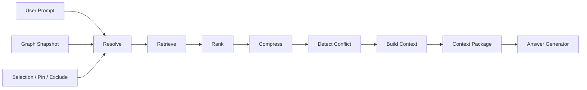
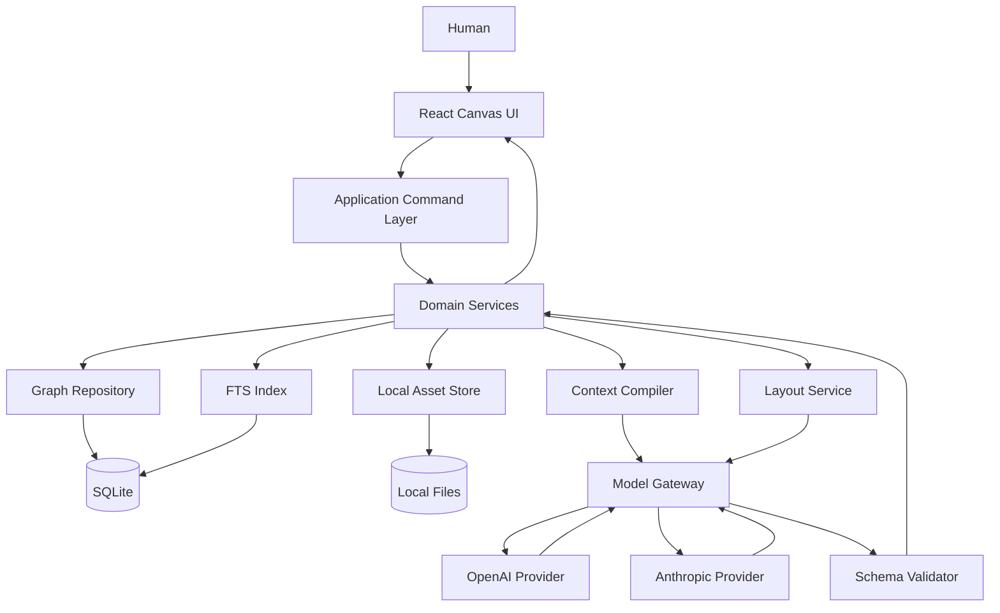
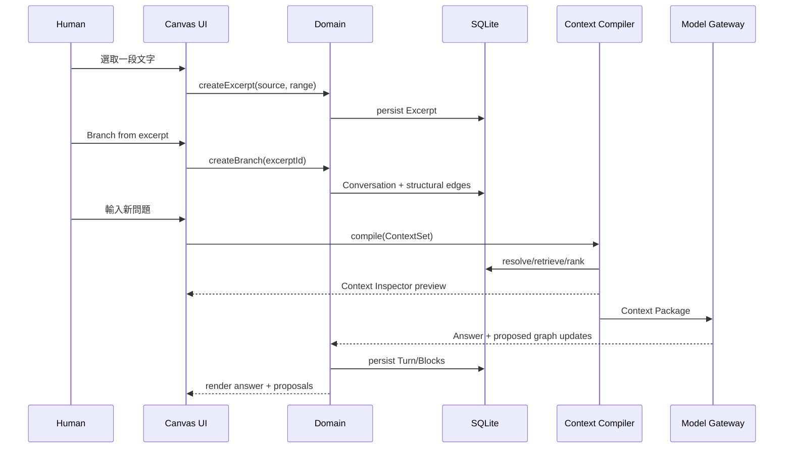
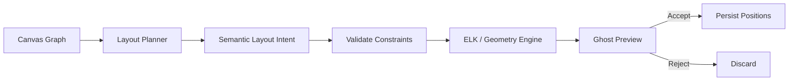
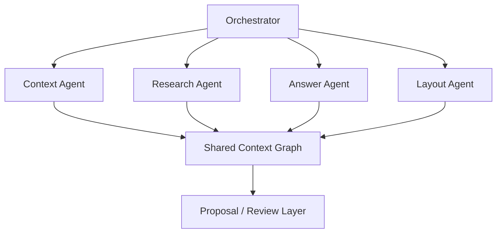

# AI Context Canvas：可直接導入 Cowork / Codex 的專案啟動文件與開發規格

## Executive Summary

AI Context Canvas 不應被定義為「有 AI 的 Obsidian Canvas」，也不應只是把傳統聊天視窗搬到無限畫布上。它更適合被定義成：

> **一個讓人與 AI 共同看見、控制、組織與編譯 Context 的空間式對話介面。**

其核心產品假設是：目前主流 AI 對話 UI 把複雜思考壓縮成單一時間軸，使用者難以知道「AI 此刻究竟參考了哪些內容、忽略了哪些內容、哪些舊結論已失效」，而模型即使擁有很長的 context window，也不代表能穩定利用其中所有資訊。研究顯示，相關資訊位於長上下文不同位置時，模型表現可能顯著變化，尤其資訊埋在中段時可能退化；因此本產品的目標不應是「盡可能塞更多 context」，而是**讓 context 成為可選擇、可排序、可壓縮、可追溯、可視化的結構化資產**。citeturn16view2

Obsidian 與 JSON Canvas 已經證明「筆記／檔案＋節點＋邊＋空間位置」是可行的畫布抽象。JSON Canvas 1.0 的核心格式主要是 `nodes` 和 `edges`，節點類型包括 text、file、link、group；這是一個通用視覺 Canvas 規格，但並沒有在格式層定義 Conversation、Turn、Excerpt、Context Set、Context lifecycle 或「本輪模型使用哪些上下文」等 AI 對話語義。這正是 AI Context Canvas 最應該建立差異化的地方。citeturn14view2

本報告建議 MVP **先只使用一個底層模型**，不要一開始建立真正自治的多 Agent 系統。Context Manager、Layout Planner、Semantic Linker、Summarizer、Answer Generator 應先實作為「同一模型的不同 role workflow」，由 deterministic code orchestration 控制。Anthropic 的工程建議同樣區分了預先定義程式路徑的 workflows 與模型自行決定流程的 agents，並建議先採用能解決問題的最簡單方案，再在必要時增加 agentic complexity。citeturn16view0turn16view1

第一版最重要的不是自動生成漂亮知識圖，而是完成以下閉環：

```text
使用者開啟 Canvas
      ↓
開始 AI 對話
      ↓
選取一段 AI / Human 回覆
      ↓
產生有 provenance 的 Excerpt
      ↓
由 Excerpt 開啟新分支
      ↓
Canvas 顯示結構關係
      ↓
使用者選擇 / Pin / 排除 Context
      ↓
Context Compiler 建立 Context Package
      ↓
Context Inspector 告訴使用者：
「這一輪 AI 到底使用了什麼」
      ↓
AI 回答
      ↓
答案與來源繼續形成可追溯的 Graph
```

**建議技術基線**為 TypeScript + React + React Flow + Node.js API + SQLite。React Flow 已具備建立 node-based interface 所需的基礎能力，其官方範例也涵蓋 auto-layout、expand/collapse、grouping、undo/redo、Yjs 協作等模式，因此適合拿來建 Canvas UI，而非自己從 SVG/pointer events 開始重造整套編輯器。citeturn15view1turn16view4 SQLite 則可同時承擔本地結構資料、交易與 FTS5 全文檢索；FTS5 原生支援全文搜尋及 relevance ordering，足以支撐 MVP 的 lexical retrieval。citeturn15view2

LLM 層建議採 provider abstraction，而不是把資料結構綁死在某一家 API。OpenAI 的 Responses API 是目前官方建議的新專案 API，支援 multimodal、multi-turn、工具等能力；Structured Outputs 可依 JSON Schema 約束模型輸出。Anthropic 同樣提供 structured outputs，因此各 role 的輸出都應先經 schema validation 才能進入 domain layer。citeturn15view6turn14view4turn14view5

若要直接交給工程 Agent 執行，**Codex CLI 比 Cowork 更適合作為主要 coding executor**：官方文件明確將 Codex CLI 定位為直接在本機 repository 中檢查、編輯、執行程式的工具，且 `/init` 可建立 `AGENTS.md`。citeturn14view1 Cowork 可以讀寫使用者授權的本機資料夾，但目前 Cowork 工作 session 本身是在 Anthropic cloud 的隔離環境執行，透過 Desktop 連到本機檔案，因此不應把「用 Cowork 開發」誤稱成「完全離線、本機執行」。citeturn14view0turn15view5

**目前未指定且工程啟動時必須記錄的產品假設：**

| 項目 | 目前狀態 | 本報告暫定處理 |
|---|---|---|
| 核心目標使用者 | **未指定** | 先以需要長時間 AI 研究、設計、寫作、開發思考的單人知識工作者為測試 persona |
| 首發 OS | **未指定** | Web localhost 優先；不綁 macOS / Windows |
| 首發 LLM provider | **未指定** | Provider abstraction；本地 `.env` 選 OpenAI 或 Anthropic |
| 固定使用哪個模型 | **未指定** | 由設定檔選擇，不寫死 |
| AI 推理是否必須完全本地 | **未指定** | 資料 local-first；模型預設可為遠端 API |
| 隱私／合規要求 | **未指定** | MVP 不宣稱企業級 compliance |
| 多人協作 | **未指定** | 不納入 MVP |
| 行動版 | **未指定** | 不納入 MVP |
| 商業模式 | **未指定** | 不影響第一版架構 |
| Obsidian 雙向同步 | **未指定** | 先做 import/export adapter，不做 live sync |

工程上最重要的決策可以濃縮成一句：

> **Canvas 是 View；Conversation Graph 是歷史；Semantic Graph 是意義；Context Compiler 才是產品核心。**

---

## 產品定位、差異化與 MVP

**產品概述**

AI Context Canvas 應該把「一次 AI 對話」從不可逆的直線：

```text
Prompt
  ↓
Answer
  ↓
Prompt
  ↓
Answer
  ↓
...
```

轉化成可探索的有向 Graph：

```text
                           ┌── 技術方案 ─── 新對話
                           │
原始問題 ── AI 回答 ── Excerpt
                           │
                           ├── 反論 ────── 新對話
                           │
                           └── 商業模式 ── 新對話

另一條研究鏈 ────────────────────┘
```

但 Graph 本身不是價值終點。真正的產品循環應該是：

```text
Conversation
     ↓
Graph
     ↓
Context Selection
     ↓
Context Compilation
     ↓
AI Reasoning
     ↓
New Graph
```

也就是使用者與 AI 共用同一張「思考地圖」。

**與 Obsidian 的差異化**

Obsidian 本身已提供筆記連結、Graph 與 Canvas；JSON Canvas 規格也已將通用 Canvas 定義為 node/edge 模型。citeturn14view2 因此產品不能把「卡片可以拉線」當成核心創新。

| 維度 | Obsidian / 通用 JSON Canvas | AI Context Canvas 建議定位 |
|---|---|---|
| 基本單位 | text / file / link / group 等通用 node citeturn14view2 | Conversation / Turn / Excerpt / Summary / Concept / Artifact / Region |
| 主要目的 | 資訊組織、筆記與視覺 Canvas | AI 對話的 context management |
| 對話 provenance | 非 JSON Canvas 規格核心 | 一等公民 |
| 文字節選 | 可以建立文字或引用，但通用格式不表達 AI 對話 source semantics | Excerpt 保留精確 source block、range、snapshot |
| Edge | 通用節點間連線 citeturn14view2 | Structural edge 與 Semantic edge 分離 |
| AI 當前 context | 非 JSON Canvas 格式概念 | Context Set 一等公民 |
| 舊資訊失效 | 非 Canvas 核心語義 | `superseded / rejected / deprecated` |
| AI 引用透明度 | 非核心資料模型 | Context Inspector |
| Prompt 建立方式 | 外部／plugin 決定 | Canvas Graph → Context Compiler → Context Package |
| AI 建議關聯 | 可由 plugin 實作 | Proposal → confidence → user confirmation |
| 長對話呈現 | 通用卡片 | Semantic zoom + focus layer |
| Layout | 人工排版為主 | Manual / Assist / Auto，AI 僅產生 intent |
| 人與 AI 的共用模型 | 人看到筆記圖 | 人與 AI 使用同一套 node IDs、edges、states 與 context selection |

產品的一句話定位建議為：

> **AI Context Canvas 是一個「可視、可控、可編譯」的 AI 對話上下文工作空間。**

而不是：

> AI whiteboard。

或：

> Obsidian with ChatGPT。

**MVP 優先級**

`P0` 是能證明核心假設的功能；`P1` 是完成產品體驗的重要能力；`P2` 是核心價值成立後再加入。

| 優先級 | 功能 | MVP 行為 | 成功標準 |
|---|---|---|---|
| P0 | Infinite Canvas | pan / zoom / node drag / edges | 100+ nodes 仍可正常操作 |
| P0 | Conversation Node | 在 Canvas 開始一條人機對話 | turn 完整持久化 |
| P0 | Turn provenance | 每一 turn 知道 parent、actor、model、時間 | reload 後結構不變 |
| P0 | Text Excerpt | 選字後建立 excerpt | 能回到 source block + range |
| P0 | Branch from Excerpt | Excerpt 開新 conversation branch | 新舊 branch 都保留 |
| P0 | Structural Edges | reply / branch / excerpt 等 | 不由 LLM 猜測 |
| P0 | Focus Layer | 進入長 Conversation 閱讀完整內容 | 不在 Canvas 上無限撐高 node |
| P0 | Context Set | selected / pinned / excluded context | 每次 AI call 有 context_set_id |
| P0 | Context Compiler v0 | Resolve → Retrieve → Rank → Compress → Conflict → Build | 產生 deterministic Context Package |
| P0 | Context Inspector | 顯示此輪用了／沒用哪些 node | 可點擊反向定位 Canvas node |
| P0 | Single-model gateway | OpenAI 或 Anthropic 任一 provider 可工作 | domain 不依賴 provider payload |
| P0 | Structured role outputs | Agent-role JSON schema validation | invalid result 不寫入 graph |
| P0 | Local persistence | SQLite + local asset folder | app restart 資料仍存在 |
| P0 | Project export/import | 匯出單一 project package | import 後 IDs/provenance 保持 |
| P0 | Evals / tests | context compiler unit/e2e fixtures | CI 可重現 |
| P1 | Semantic Zoom | 不同 zoom 顯示不同 representation | 不必打開全文也能讀圖 |
| P1 | Summarizer | 生成 faithful summary | summary 保留 source IDs |
| P1 | Semantic Linker | proposed semantic edges | AI edge 預設未確認 |
| P1 | Context lifecycle | active / superseded / rejected 等 | compiler 尊重 state |
| P1 | FTS Retrieval | 在 workspace 找相關文字 | query 可排序 |
| P1 | Image Region | 框選圖片區域開 branch | selector 可重建 |
| P1 | Layout Assist | AI 建議 cluster + geometry preview | 不自動破壞人工佈局 |
| P1 | JSON Canvas adapter | 基礎 import/export | 不把其格式當內部 canonical model |
| P2 | Embedding / RAG | semantic retrieval | eval 優於 lexical-only 後啟用 |
| P2 | Auto Layout | 特定 region 自動維護 | pinned node 絕不移動 |
| P2 | 多 Agent | 並行 specialist workflows | 有 eval 證明收益 |
| P2 | Collaboration | 多人同步編輯 | 有 conflict strategy |
| P2 | PDF / code selectors | page / paragraph / symbol addressing | provenance 可還原 |

**MVP 明確不做的事**

第一版不應追求 autonomous multi-agent swarm、整個 filesystem RAG、多人即時協作、完整 Obsidian replacement、AI 自由重排整個 Canvas、跨裝置同步、plugin marketplace。這與目前 agent engineering 的實務原則一致：先用明確 workflow 和簡單組件證明核心價值，再增加複雜度。citeturn16view0turn16view1

MVP 真正應該驗證的是三個問題：

1. **Navigation test**：使用者在 30–100 turns、5–20 branches 後，是否比線性 chat 更容易找到「我們為什麼走到這裡」。
2. **Context comprehension test**：使用者是否能正確回答「AI 這一輪用了什麼 context」。
3. **Context quality test**：Context Compiler 相較「全部 ancestors 全塞」是否降低舊資訊干擾、遺漏與 branch 汙染。

第三項尤其重要。長 context 本身並不保證可靠利用資訊，因此 benchmark 應比較「raw long history」與「compiled context」，而非只比較 token 數。citeturn16view2

---

## 資料模型與 Context Compiler

資料模型不要直接等同 Canvas component state。建議分成：

```text
Domain Model
├── Workspace
├── Conversation
├── Turn
├── ContentBlock
├── Excerpt
├── Node
├── Edge
├── ContextSet
├── ContextItem
└── ContextConflict

View Model
├── NodePosition
├── NodeRepresentation
├── ZoomState
├── FocusState
└── LayoutIntent
```

這樣日後就算更換 React Flow、改成桌面 App，Conversation Graph 本身仍然成立。

### 核心實體欄位規格

**Workspace**

| 欄位 | 型別 | 必填 | 說明 |
|---|---|---:|---|
| `id` | UUID | 是 | workspace canonical ID |
| `name` | string | 是 | 工作空間名稱 |
| `description` | string/null | 否 | 使用者描述 |
| `root_node_id` | UUID/null | 否 | 預設入口 |
| `settings` | JSON | 是 | context/layout/provider 等設定 |
| `schema_version` | string | 是 | migration 用 |
| `created_at` | ISO datetime | 是 | 建立時間 |
| `updated_at` | ISO datetime | 是 | 修改時間 |

```json
{
  "id": "ws_01",
  "name": "AI Context Canvas Research",
  "description": "產品設計與 MVP 討論",
  "root_node_id": "node_root",
  "settings": {
    "layout_mode": "assist",
    "default_provider": "openai",
    "default_model": "未指定"
  },
  "schema_version": "0.1.0",
  "created_at": "2026-10-04T09:00:00+09:00",
  "updated_at": "2026-10-04T09:00:00+09:00"
}
```

**Conversation**

Conversation 是一條具有身份的討論脈絡，不等於單一 Canvas node。

| 欄位 | 型別 | 必填 | 說明 |
|---|---|---:|---|
| `id` | UUID | 是 | Conversation ID |
| `workspace_id` | UUID | 是 | 所屬 workspace |
| `title` | string | 是 | 顯示標題 |
| `status` | `active/archived` | 是 | Conversation 狀態 |
| `root_turn_id` | UUID/null | 否 | 第一個 turn |
| `summary_block_id` | UUID/null | 否 | 最新 summary |
| `branch_origin_excerpt_id` | UUID/null | 否 | 若由 excerpt 分支，記錄來源 |
| `created_at` | datetime | 是 | 建立 |
| `updated_at` | datetime | 是 | 更新 |

```json
{
  "id": "conv_context_compiler",
  "workspace_id": "ws_01",
  "title": "Context Compiler 設計",
  "status": "active",
  "root_turn_id": "turn_001",
  "summary_block_id": "block_summary_001",
  "branch_origin_excerpt_id": "excerpt_012",
  "created_at": "2026-10-04T09:05:00+09:00",
  "updated_at": "2026-10-04T10:20:00+09:00"
}
```

**Turn**

Turn 是 Conversation 中一次 actor action。不要把 user/assistant message 當純文字 blob。

| 欄位 | 型別 | 必填 | 說明 |
|---|---|---:|---|
| `id` | UUID | 是 | Turn ID |
| `conversation_id` | UUID | 是 | 所屬 conversation |
| `parent_turn_id` | UUID/null | 否 | 直接對話 predecessor |
| `actor` | `human/assistant/system/tool` | 是 | 產生者 |
| `sequence` | integer | 是 | conversation local order |
| `model_provider` | string/null | 否 | AI turn provider |
| `model_id` | string/null | 否 | AI turn model |
| `input_context_set_id` | UUID/null | 否 | 產生此 AI turn 所用 context |
| `status` | `complete/streaming/error` | 是 | generation state |
| `created_at` | datetime | 是 | 建立時間 |

```json
{
  "id": "turn_042",
  "conversation_id": "conv_context_compiler",
  "parent_turn_id": "turn_041",
  "actor": "assistant",
  "sequence": 42,
  "model_provider": "openai",
  "model_id": "未指定",
  "input_context_set_id": "ctx_042",
  "status": "complete",
  "created_at": "2026-10-04T10:21:00+09:00"
}
```

**ContentBlock**

一個 Turn 可包含多個內容 block，使文字、圖像、code、表格與 tool result 可獨立 address。

| 欄位 | 型別 | 必填 | 說明 |
|---|---|---:|---|
| `id` | UUID | 是 | Block ID |
| `turn_id` | UUID/null | 否 | 所屬 turn；獨立 artifact 可為 null |
| `block_type` | enum | 是 | `text/markdown/image/code/table/file/tool_result` |
| `ordinal` | integer | 是 | block 順序 |
| `mime_type` | string/null | 否 | asset MIME |
| `text_content` | string/null | 否 | 文字內容 |
| `asset_id` | UUID/null | 否 | 圖／檔資產 |
| `structured_data` | JSON/null | 否 | table/tool/code metadata |
| `content_hash` | string | 是 | provenance / mutation check |
| `created_at` | datetime | 是 | 建立 |
| `updated_at` | datetime | 是 | 更新 |

```json
{
  "id": "block_042_01",
  "turn_id": "turn_042",
  "block_type": "markdown",
  "ordinal": 0,
  "mime_type": "text/markdown",
  "text_content": "Context 不應等於所有 ancestors。",
  "asset_id": null,
  "structured_data": null,
  "content_hash": "sha256:9f0example",
  "created_at": "2026-10-04T10:21:00+09:00",
  "updated_at": "2026-10-04T10:21:00+09:00"
}
```

**Excerpt**

Excerpt 必須是一等實體，而不是把被選的字 copy 成新 note。

| 欄位 | 型別 | 必填 | 說明 |
|---|---|---:|---|
| `id` | UUID | 是 | Excerpt ID |
| `workspace_id` | UUID | 是 | workspace |
| `source_block_id` | UUID | 是 | canonical source |
| `selector` | JSON | 是 | text range / image region 等 |
| `snapshot_text` | string/null | 否 | 建立時內容快照 |
| `source_content_hash` | string | 是 | 驗證來源是否改變 |
| `title` | string/null | 否 | 可由人／AI命名 |
| `created_by` | `human/ai/system` | 是 | provenance |
| `created_at` | datetime | 是 | 建立 |

文字 selector：

```json
{
  "id": "excerpt_012",
  "workspace_id": "ws_01",
  "source_block_id": "block_042_01",
  "selector": {
    "type": "text_range",
    "start_char": 0,
    "end_char": 27,
    "exact": "Context 不應等於所有 ancestors。"
  },
  "snapshot_text": "Context 不應等於所有 ancestors。",
  "source_content_hash": "sha256:9f0example",
  "title": "Context selection 原則",
  "created_by": "human",
  "created_at": "2026-10-04T10:23:00+09:00"
}
```

圖片 region 可使用矩形 selector。W3C Media Fragments 已定義以 `x,y,width,height`、pixel 或百分比方式表達視覺媒體矩形區域，因此此設計有成熟標準作為概念參照。citeturn16view3 實作上建議優先存 normalized coordinate，並額外保留原始 pixel metadata，以避免 UI resize 後 selector 失真。

```json
{
  "type": "image_region",
  "asset_id": "asset_ui_mock_01",
  "unit": "normalized",
  "x": 0.18,
  "y": 0.12,
  "width": 0.42,
  "height": 0.23,
  "source_pixel_size": {
    "width": 1920,
    "height": 1080
  },
  "pixel_snapshot": {
    "x": 346,
    "y": 130,
    "width": 806,
    "height": 248
  }
}
```

**Node**

Node 是「某個 domain object 在 Canvas 上的 representation」，不是 domain object 本身。

| 欄位 | 型別 | 必填 | 說明 |
|---|---|---:|---|
| `id` | UUID | 是 | node ID |
| `workspace_id` | UUID | 是 | workspace |
| `type` | NodeType | 是 | 見下表 |
| `ref_type` | string/null | 否 | 對應 domain entity |
| `ref_id` | UUID/null | 否 | domain ID |
| `title` | string | 是 | UI title |
| `context_state` | ContextState | 是 | AI context lifecycle |
| `x` | float | 是 | world coordinate |
| `y` | float | 是 | world coordinate |
| `width` | float | 是 | UI width |
| `height` | float | 是 | UI height |
| `z_index` | integer | 是 | rendering order |
| `collapsed` | boolean | 是 | 是否折疊 |
| `visibility` | enum | 是 | `normal/muted/hidden` |
| `representation` | JSON | 是 | 不同 zoom 的呈現資料 |
| `created_by` | enum | 是 | human/ai/system |
| `created_at` | datetime | 是 | 建立 |
| `updated_at` | datetime | 是 | 更新 |

```json
{
  "id": "node_excerpt_012",
  "workspace_id": "ws_01",
  "type": "excerpt",
  "ref_type": "excerpt",
  "ref_id": "excerpt_012",
  "title": "Context selection 原則",
  "context_state": "active",
  "x": 1280,
  "y": 640,
  "width": 320,
  "height": 180,
  "z_index": 14,
  "collapsed": false,
  "visibility": "normal",
  "representation": {
    "overview": "Context selection 原則",
    "summary": "Context 不應只等同 ancestor chain。",
    "detail": "source"
  },
  "created_by": "human",
  "created_at": "2026-10-04T10:23:00+09:00",
  "updated_at": "2026-10-04T10:23:00+09:00"
}
```

**建議 Node Types**

| Node type | 意義 | MVP |
|---|---|---:|
| `conversation` | 對話容器 | P0 |
| `turn` | 特定 turn representation | P0 |
| `excerpt` | 來源精確節選 | P0 |
| `summary` | 一組內容的摘要 | P1 |
| `concept` | 抽象概念 | P1 |
| `artifact` | code/table/document 等成果 | P1 |
| `reference` | URL / file / external source | P1 |
| `image_region` | 圖片局部 | P1 |
| `group` | 視覺／語義 cluster | P1 |

**Edge**

最重要的原則是 Structural 與 Semantic 不混用。

| 欄位 | 型別 | 必填 | 說明 |
|---|---|---:|---|
| `id` | UUID | 是 | Edge ID |
| `workspace_id` | UUID | 是 | workspace |
| `source_node_id` | UUID | 是 | source |
| `target_node_id` | UUID | 是 | target |
| `edge_class` | `structural/semantic` | 是 | 類別 |
| `type` | EdgeType | 是 | relation |
| `direction` | `directed/undirected` | 是 | 方向 |
| `provenance` | `user/ai/system` | 是 | 誰建立 |
| `confidence` | 0..1/null | 否 | AI suggestion |
| `confirmed` | boolean | 是 | user confirmed? |
| `label` | string/null | 否 | 顯示 label |
| `metadata` | JSON | 是 | 額外資料 |
| `created_at` | datetime | 是 | 建立 |
| `updated_at` | datetime | 是 | 更新 |

```json
{
  "id": "edge_087",
  "workspace_id": "ws_01",
  "source_node_id": "node_excerpt_012",
  "target_node_id": "node_conv_044",
  "edge_class": "structural",
  "type": "branch_from",
  "direction": "directed",
  "provenance": "system",
  "confidence": null,
  "confirmed": true,
  "label": null,
  "metadata": {},
  "created_at": "2026-10-04T10:25:00+09:00",
  "updated_at": "2026-10-04T10:25:00+09:00"
}
```

Structural Edge 建議：

```text
reply_to
branch_from
excerpt_from
continue_from
generated_from
merge_from
contains
region_of
summarizes
```

Structural edge 必須由應用程式已知事件產生，不讓模型推測。

Semantic Edge 建議：

```text
supports
contradicts
elaborates
example_of
depends_on
alternative_to
related_to
supersedes
```

Semantic edge 可由 AI 提議，但應為：

```text
AI proposal
    ↓
confidence + evidence
    ↓
pending
    ↓
user accept / reject
```

而非直接升格為事實。

**Context Node State**

| State | 語義 | Compiler 預設 |
|---|---|---|
| `active` | 目前有效資訊 | 正常納入 |
| `confirmed` | 使用者明確確認 | 高優先 |
| `hypothesis` | 假設／尚未證實 | 可納入但標記 |
| `superseded` | 被新資訊取代 | 預設不當目前事實 |
| `deprecated` | 不建議再使用 | 大幅降權 |
| `rejected` | 使用者明確否決 | 預設排除 |
| `reference` | 背景資料 | 依 query relevance |
| `unknown` | 尚未分類 | 中性 |

例如：

```text
Node A
「第一版用 Neo4j」
state = superseded
      │
      └── supersedes ──→
Node K
「第一版改用 SQLite」
state = confirmed
```

模型仍可以看到 A 作為歷史，但 Context Package 不應把 A 和 K 當兩個同等有效的現況。

**Context Set**

Context Set 描述「某次模型呼叫之前，人與系統決定有哪些 candidate context」。

| 欄位 | 型別 | 必填 | 說明 |
|---|---|---:|---|
| `id` | UUID | 是 | Context Set ID |
| `workspace_id` | UUID | 是 | workspace |
| `conversation_id` | UUID/null | 否 | current conversation |
| `target_turn_id` | UUID/null | 否 | 即將產生的 turn |
| `current_node_id` | UUID/null | 否 | UI current focus |
| `prompt_text` | string | 是 | user prompt |
| `selected_node_ids` | UUID[] | 是 | 當輪顯式選取 |
| `pinned_node_ids` | UUID[] | 是 | 長期 pin |
| `excluded_node_ids` | UUID[] | 是 | 顯式排除 |
| `retrieved_items` | ContextItem[] | 是 | compiler retrieval |
| `budget` | JSON | 是 | token budget |
| `policy_version` | string | 是 | compiler policy |
| `status` | enum | 是 | draft/compiled/used |
| `created_at` | datetime | 是 | 建立 |

```json
{
  "id": "ctx_042",
  "workspace_id": "ws_01",
  "conversation_id": "conv_context_compiler",
  "target_turn_id": "turn_042",
  "current_node_id": "node_conv_context",
  "prompt_text": "Context Compiler 應該怎麼排序 context？",
  "selected_node_ids": ["node_excerpt_012"],
  "pinned_node_ids": ["node_product_principle"],
  "excluded_node_ids": ["node_old_neo4j_plan"],
  "retrieved_items": [],
  "budget": {
    "max_input_tokens": 64000,
    "reserved_output_tokens": 8000,
    "target_context_tokens": 24000
  },
  "policy_version": "context-policy-0.1",
  "status": "draft",
  "created_at": "2026-10-04T10:24:00+09:00"
}
```

**ContextItem**

```json
{
  "source_type": "excerpt",
  "source_id": "excerpt_012",
  "node_id": "node_excerpt_012",
  "role": "selected",
  "state": "active",
  "scores": {
    "explicit": 1.0,
    "structural": 0.9,
    "semantic": 0.92,
    "recency": 0.8,
    "state": 1.0,
    "spatial": 0.3,
    "final": 0.94
  },
  "reason": "使用者本輪明確選取，且與 query 直接相關",
  "token_estimate": 34,
  "compressed": false,
  "content_hash": "sha256:9f0example"
}
```

空間鄰近只能視為弱 signal。使用者把兩個 node 放得近，可能代表「相關」，也可能只是排版。因此 `spatial` 權重不可高於顯式選取、結構關係或內容相關度。

### Context Compiler

Context Compiler 是產品中最接近「compiler」而不是「chat history builder」的核心。



**輸入**

```ts
type ContextCompileInput = {
  workspaceId: string;
  conversationId?: string;
  currentNodeId?: string;
  prompt: string;

  selectedNodeIds: string[];
  pinnedNodeIds: string[];
  excludedNodeIds: string[];

  graphSnapshotVersion: string;
  tokenBudget: {
    maxInputTokens: number;
    reservedOutputTokens: number;
    targetContextTokens: number;
  };

  policyVersion: string;
};
```

**Resolve**

Resolve 不做「AI 判斷」，而是把 UI 操作解析成 canonical references。

例如：

```text
Canvas Node
   ↓
ref_id
   ↓
Excerpt
   ↓
source_block_id
   ↓
Turn
   ↓
Conversation
```

此階段應完成：

```text
node ID resolution
excerpt → source resolution
content hash verification
deleted/missing reference detection
context state lookup
structural ancestry resolution
explicit user override resolution
```

原則：

> 使用者明確 Pin / Select / Exclude 的操作優先於 AI 推斷。

**Retrieve**

MVP 建議使用混合但偏 deterministic 的 retrieval：

```text
Candidate Pool
├── explicit selected
├── pinned
├── current conversation ancestors
├── branch origin excerpt
├── direct structural neighbors
├── confirmed related nodes
└── SQLite FTS5 lexical results
```

FTS5 可在 SQLite 內完成 full-text query 與 relevance ordering，因此 MVP 不需要先部署另一個 vector database。citeturn15view2

Phase 2 再加入：

```text
embedding retrieval
contextual chunk retrieval
reranking
cross-workspace retrieval
```

Anthropic 的 Contextual Retrieval 實驗指出，在傳統 chunk retrieval 之外加入 chunk-specific context，再搭配 BM25 / reranking，可以降低 retrieval failure；這可以作為未來 RAG 路線參考，而不是 MVP 的必要依賴。citeturn15view7

**Rank**

推薦先採可解釋的 scoring，而不是直接問 LLM「哪些比較重要」。

範例：

```text
if explicitly_selected:
    score = 1.00
else if pinned:
    score >= 0.95
else:
    score =
      0.30 * structural_relevance +
      0.25 * semantic_relevance +
      0.15 * lexical_relevance +
      0.15 * state_score +
      0.10 * recency_score +
      0.05 * spatial_signal
```

實際權重是**未指定**，必須透過 eval fixture 調整；上式只是第一版可測 baseline。

另外應套用 hard rules：

```text
rejected       → exclude unless explicitly requested
superseded     → historical only
confirmed      → boost
selected       → always retain unless impossible
excluded       → never include
```

**Compress**

當 candidate 超出 budget 時，不應單純 truncate。

推薦層次：

```text
Raw pinned excerpt
        ↓ 不壓縮
Current prompt / selected content
        ↓ 優先保留原文
Direct source facts
        ↓ 優先保留
Low-priority historical discussion
        ↓ summary
Large old branches
        ↓ branch summary
Repeated context
        ↓ deduplicate
```

每個壓縮結果必須保留：

```text
summary_id
source_ids[]
source_content_hashes[]
summary_version
```

這一點是為了阻止 summary 逐代改寫造成 provenance drift。

**Detect Conflict**

先 deterministic，再 semantic。

```text
Stage A
explicit supersedes edge
rejected state
duplicate source
content version mismatch

Stage B
high-ranking facts
     ↓
LLM conflict classifier
     ↓
contradiction proposal
```

範例：

```json
{
  "a": "node_neo4j",
  "b": "node_sqlite",
  "type": "superseded_by",
  "resolution": "prefer_b",
  "reason": "node_sqlite is confirmed; node_neo4j is superseded",
  "status": "resolved"
}
```

**Build Context**

最終不是「把文字 concat 起來」，而是建立有語義區段的 Context Package：

```text
System instructions

Current goal
Current user prompt

Explicit context
├ selected
└ pinned

Active canonical context

Referenced context

Retrieved context

Historical context
└ clearly marked as historical/superseded

Conflict notes

Source map
```

這種有選擇地建 context 比「整串歷史無差別塞入」更符合產品目標；長上下文研究已顯示，相關資訊存在於長 prompt 中並不代表模型總能同等可靠地使用它。citeturn16view2

**Context Package 範例**

```json
{
  "package_id": "pkg_042",
  "context_set_id": "ctx_042",
  "policy_version": "context-policy-0.1",
  "goal": "回答 Context Compiler 的排序設計問題",
  "current_prompt": "Context Compiler 應該怎麼排序 context？",
  "items": [
    {
      "source_id": "excerpt_012",
      "node_id": "node_excerpt_012",
      "role": "selected",
      "state": "active",
      "content": "Context 不應等於所有 ancestors。",
      "score": 1.0,
      "reason": "explicit user selection",
      "compressed": false
    },
    {
      "source_id": "node_product_principle",
      "node_id": "node_product_principle",
      "role": "pinned",
      "state": "confirmed",
      "content": "人與 AI 應共享同一套可視化 context map。",
      "score": 0.98,
      "reason": "workspace pinned product principle",
      "compressed": false
    },
    {
      "source_id": "summary_old_context",
      "node_id": "node_old_branch",
      "role": "retrieved",
      "state": "reference",
      "content": "早期方案使用 ancestor-only context，但已發現無法處理跨 branch relevance。",
      "score": 0.71,
      "reason": "historical comparison",
      "compressed": true
    }
  ],
  "conflicts": [
    {
      "a": "node_old_neo4j_plan",
      "b": "node_sqlite_plan",
      "type": "superseded_by",
      "resolution": "prefer_b",
      "status": "resolved"
    }
  ],
  "excluded": [
    {
      "source_id": "node_old_neo4j_plan",
      "reason": "explicitly excluded and superseded"
    }
  ],
  "budget": {
    "max_input_tokens": 64000,
    "target_context_tokens": 24000,
    "used_context_tokens": 8421,
    "reserved_output_tokens": 8000
  },
  "trace": {
    "resolved_candidates": 31,
    "retrieved_candidates": 18,
    "ranked_candidates": 18,
    "included_items": 9,
    "compressed_items": 2
  }
}
```

Context Inspector 應直接呈現此 package，而不是重新用另一套邏輯猜「AI 大概看了什麼」。

---

## 系統架構、Agent 分工與技術選型

### 系統架構

建議從 local-first modular monolith 開始，不要在 MVP 建 microservices。



一次「由節選建立 branch 並問 AI」的流程：



### Agent 分工

第一版的「Agent」更準確地說是 **role-specific workflows**。

Anthropic 將 workflow 定義為由程式碼預先決定執行路徑，而 agent 則讓模型動態控制自己的流程與工具；其官方工程文章建議先用最簡單可行方案，並指出 workflow 在明確任務上具有較高可預測性。citeturn16view0turn16view1

因此建議：

```text
One underlying model
        │
        ├── Context Manager prompt
        ├── Layout Planner prompt
        ├── Semantic Linker prompt
        ├── Summarizer prompt
        └── Answer Generator prompt
```

而不是：

```text
5 autonomous agents
   ↕
互相聊天
   ↕
自行修改 DB
```

模型輸出必須使用 JSON Schema / structured output。OpenAI Structured Outputs 官方文件明確支援依 supplied JSON Schema 約束輸出；Anthropic 亦提供 structured outputs，但兩家的 schema constraints 並不完全相同，因此 domain schema 應由本地 validator 再驗一次。citeturn14view4turn14view5

| Role | 主要責任 | Input | Output | 可直接修改 Graph？ |
|---|---|---|---|---:|
| Context Manager | 對 ambiguous candidates 做 relevance/conflict 輔助判斷 | query + candidate metadata | context decisions | 否 |
| Layout Planner | 決定 cluster / visual intent | graph summary + bounds | `LayoutIntent[]` | 否 |
| Semantic Linker | 提出語義關聯 | nodes/content | proposed edges | 否 |
| Summarizer | 壓縮 branch / node | source blocks | sourced summary | 否 |
| Answer Generator | 產生使用者答案 | Context Package | answer + graph proposals | 只能 proposal |

**Context Manager system prompt 範例**

```text
You are the Context Manager for AI Context Canvas.

Your job is NOT to answer the user's question.
Your job is to evaluate candidate context items for relevance.

Rules:
1. Preserve all provided source IDs exactly.
2. Never invent a node, excerpt, source, relation, or state.
3. Explicitly selected and pinned items are controlled by application policy,
   not by you.
4. Treat rejected and superseded content as historical unless the query
   explicitly asks about history.
5. Identify potential contradictions only when evidence exists.
6. Do not rewrite source facts.
7. Return only the requested structured output.

For every candidate, return:
- source_id
- semantic_relevance: 0..1
- reason
- potential_conflict_ids[]
```

I/O：

```json
{
  "input": {
    "query": "第一版要選 SQLite 還是 Neo4j？",
    "candidates": [
      {
        "source_id": "node_a",
        "state": "superseded",
        "text": "第一版用 Neo4j"
      },
      {
        "source_id": "node_b",
        "state": "confirmed",
        "text": "第一版改用 SQLite"
      }
    ]
  },
  "output": {
    "decisions": [
      {
        "source_id": "node_a",
        "semantic_relevance": 0.76,
        "reason": "與問題相關但屬歷史方案",
        "potential_conflict_ids": ["node_b"]
      },
      {
        "source_id": "node_b",
        "semantic_relevance": 0.99,
        "reason": "目前確認方案",
        "potential_conflict_ids": ["node_a"]
      }
    ]
  }
}
```

**Layout Planner system prompt 範例**

```text
You are the Layout Planner for AI Context Canvas.

You propose layout intentions. You do not move nodes directly.

Goals:
- improve readability,
- reveal conversation branching,
- preserve the user's spatial memory,
- minimize unnecessary movement.

Hard rules:
1. Never propose moving pinned nodes.
2. Preserve user-created clusters unless a clear conflict exists.
3. Prefer local changes over whole-canvas rearrangement.
4. Return semantic grouping intent, not pixel-perfect free-form artwork.
5. Every operation needs a reason and confidence.
6. In Assist mode every change requires preview/acceptance.

Return LayoutIntent JSON only.
```

Input：

```json
{
  "mode": "assist",
  "viewport": {
    "x": 900,
    "y": 400,
    "width": 1400,
    "height": 900
  },
  "nodes": [
    {
      "id": "a",
      "title": "Context Engine",
      "pinned": true
    },
    {
      "id": "b",
      "title": "Context Inspector",
      "pinned": false
    }
  ],
  "edges": [
    {
      "source": "a",
      "target": "b",
      "type": "elaborates"
    }
  ]
}
```

Output：

```json
{
  "intents": [
    {
      "type": "cluster",
      "node_ids": ["a", "b"],
      "label": "Context Architecture",
      "reason": "兩節點屬同一產品子系統",
      "confidence": 0.91,
      "requires_confirmation": true
    }
  ]
}
```

**Semantic Linker system prompt 範例**

```text
You are the Semantic Linker.

Find meaningful semantic relationships between supplied nodes.

Allowed relationship types:
supports, contradicts, elaborates, example_of,
depends_on, alternative_to, related_to, supersedes.

Rules:
1. Never create structural relationships such as reply_to or branch_from.
2. Do not infer a relation if evidence is weak.
3. Cite the exact source IDs used as evidence.
4. Confidence below 0.65 should normally return no proposal.
5. Every result is a proposal, never a confirmed fact.
6. Return JSON only.
```

Output：

```json
{
  "proposals": [
    {
      "source_node_id": "node_context_set",
      "target_node_id": "node_context_inspector",
      "type": "depends_on",
      "confidence": 0.88,
      "evidence_source_ids": [
        "block_11",
        "block_27"
      ],
      "reason": "Inspector 的顯示資料直接來源為 Context Set"
    }
  ]
}
```

**Summarizer system prompt 範例**

```text
You are the Summarizer.

Produce a compact faithful summary of the supplied source blocks.

The summary must distinguish:
- confirmed decisions,
- hypotheses,
- rejected ideas,
- unresolved questions.

Rules:
1. Do not add new claims.
2. Preserve source IDs for every important statement.
3. Never turn a hypothesis into a confirmed decision.
4. Preserve contradictions instead of silently resolving them.
5. Return JSON only.
```

Output：

```json
{
  "summary": "MVP 決定先使用 SQLite；Neo4j 方案已被取代。",
  "decisions": [
    {
      "text": "MVP 使用 SQLite",
      "source_ids": ["node_sqlite"]
    }
  ],
  "rejected_or_superseded": [
    {
      "text": "MVP 使用 Neo4j",
      "source_ids": ["node_neo4j"]
    }
  ],
  "open_questions": [],
  "source_ids": [
    "node_sqlite",
    "node_neo4j"
  ]
}
```

**Answer Generator system prompt 範例**

```text
You are the Answer Generator for AI Context Canvas.

Answer the user's current request using the supplied Context Package.

Rules:
1. Treat the Context Package as the authoritative application context.
2. Respect context state:
   confirmed > active > hypothesis > historical/superseded.
3. Never silently rely on an excluded source.
4. If context contains an unresolved conflict, surface the conflict.
5. Do not claim that you saw a node that is not in the package.
6. Return:
   - answer
   - used_source_ids
   - suggested_graph_updates
7. Suggested graph updates are proposals and must never mutate storage directly.
```

Output：

```json
{
  "answer": "第一版建議採 SQLite，因為目前確認的架構決策已將 Neo4j 標為 superseded。",
  "used_source_ids": [
    "node_sqlite",
    "node_neo4j"
  ],
  "suggested_graph_updates": [
    {
      "type": "summary_node",
      "reason": "此輪形成明確技術決策",
      "source_ids": [
        "node_sqlite",
        "node_neo4j"
      ]
    }
  ]
}
```

### 技術選型

| 層 | 建議 | 原因 |
|---|---|---|
| 語言 | TypeScript | frontend/backend/domain schema 共用 |
| Frontend | React + Vite | 快速 local app |
| Canvas | `@xyflow/react` / React Flow | node/edge interaction 基礎成熟；官方已有 layout、collapse、collaboration 等範例 citeturn15view1turn16view4 |
| State | Zustand 或 equivalent | Canvas transient state 與 server/domain 分開 |
| API | Node.js + Fastify 類型的薄 API | 保持單一 TS stack |
| Validation | Zod + JSON Schema export | domain + LLM structured output 共用 |
| DB | SQLite | local-first、單人 MVP、低維運 |
| Search | SQLite FTS5 | 不先引入另一個 search service；支援 relevance ordering citeturn15view2 |
| ORM | Drizzle 類型薄 ORM 或直接 SQL | schema migration 清楚 |
| Graph persistence | SQLite `nodes` / `edges` adjacency tables | MVP 不需要 Neo4j |
| Graph DB | **MVP 不採用** | 專用 graph infrastructure 暫無必要 |
| Layout geometry | ELK.js / deterministic layout engine | LLM 提 intent，演算法算 geometry；React Flow 官方已有 ELK/dagre 類 auto-layout 示例 citeturn16view4 |
| LLM API | Provider adapter | OpenAI / Anthropic 可替換 |
| OpenAI | Responses API | 官方推薦新專案採 Responses citeturn15view6 |
| Structured output | provider native + local validation | OpenAI、Anthropic 均支援 structured output citeturn14view4turn14view5 |
| Assets | `data/assets/` + SHA-256 metadata | 簡單 local provenance |
| Test | Vitest + Playwright 類型組合 | unit + browser interaction |
| Deployment | localhost web app | MVP 最少 packaging complexity |
| Desktop | 未指定；Phase 2 可考慮 wrapper | 先驗證 UX 再決定 |

**為什麼 MVP 不用 Neo4j**

這裡的圖雖然是真 Graph，但「資料結構是 graph」不等於「第一天就必須用 graph database」。

MVP 主要 query 可以用：

```sql
nodes
edges
conversations
turns
content_blocks
excerpts
context_sets
```

搭配：

```text
direct neighbors
parent chain
branch origin
workspace filter
state filter
FTS result
```

即可完成。等到實際 profiler 顯示 traversal、cross-workspace graph analytics 或 graph pattern matching 成為主要瓶頸，再抽換 `GraphRepository` implementation。

推薦先定義：

```ts
interface GraphRepository {
  getNode(id: string): Promise<Node>;
  getEdges(nodeId: string): Promise<Edge[]>;
  getNeighbors(nodeId: string, options?: QueryOptions): Promise<Node[]>;
  getAncestors(nodeId: string, maxDepth: number): Promise<Node[]>;
  saveNode(node: Node): Promise<void>;
  saveEdge(edge: Edge): Promise<void>;
}
```

如此日後 SQLite → Neo4j 不需要改 Context Compiler contract。

---

## Canvas UX、語意縮放與 Layout 規範

最危險的 UX 失敗模式是：

> 把線性聊天的「一直往下滾」問題，換成 Canvas 的「到處都是卡片和線」問題。

所以 Canvas 的核心設計不是 unlimited space，而是 **progressive disclosure**。

### Semantic Zoom

同一 Node 在不同 zoom level 不顯示相同內容。

```text
Zoom Far

┌─────────────────┐
│ Context Compiler│
│ ● confirmed     │
└─────────────────┘
```

```text
Zoom Medium

┌────────────────────────────┐
│ Context Compiler           │
│ 將 Graph 編譯成可控 context│
│                            │
│ Resolve → Retrieve → Rank  │
│ 18 turns · 3 branches      │
└────────────────────────────┘
```

```text
Zoom Near

┌──────────────────────────────┐
│ Context Compiler             │
│                              │
│ User: Context 如何排序？     │
│                              │
│ AI: 先明確選取，再……         │
│                              │
│ [Excerpt] [Branch] [Pin]     │
└──────────────────────────────┘
```

```text
Focus Layer

Canvas › Context Architecture › Context Compiler

User
──────────────────────────────
Context 如何排序？

Assistant
──────────────────────────────
完整 Markdown 回答……
完整 Markdown 回答……
完整 Markdown 回答……
```

建議定義四個 level：

| Level | 用途 | 顯示 |
|---|---|---|
| L0 Overview | 看整體圖 | title、state、branch count |
| L1 Summary | 看區塊意義 | AI/user summary、keywords |
| L2 Conversation | 看 turns | condensed messages |
| L3 Focus | 深讀 | 完整 content blocks |

長對話因此應該是：

> **同一個邏輯 Graph，不同視覺層。**

而不是把 30 turns 全展開成一張 6000px 高的卡片，也不是每次點進去就跳到完全無關的另一個 Canvas。

### Node Representation 與 Content 分離

Node 應同時有：

```text
Canonical Content
       │
       ├── Representation L0
       ├── Representation L1
       └── Representation L2
```

Representation 是 view cache，可以重新生成。

Content 是 source of truth。

例如：

```json
{
  "content_ref": "conv_context_compiler",
  "representation": {
    "l0": {
      "title": "Context Compiler",
      "badge": "confirmed"
    },
    "l1": {
      "title": "Context Compiler",
      "summary": "把視覺 Graph 編譯成模型可消化的 bounded context。",
      "key_points": [
        "Resolve",
        "Retrieve",
        "Rank",
        "Compress",
        "Conflict"
      ]
    },
    "l2": {
      "show_recent_turns": 4
    }
  }
}
```

AI 可以生成 representation，但使用者應能：

```text
Regenerate
Edit
Pin representation
Restore source-derived version
```

### Excerpt 操作

文字 selection 是本產品極重要的 interaction。

建議 selection toolbar：

```text
AI 回答：
「真正的核心不是 Canvas，而是讓人知道
 AI 此刻究竟使用了哪些 Context。」

           ┌──────────────────────────────┐
選取文字 → │ Branch │ Pin │ Link │ Quote │
           └──────────────────────────────┘
```

`Branch` 操作應原子性執行：

```text
create Excerpt
      ↓
create Excerpt Node
      ↓
create excerpt_from edge
      ↓
create new Conversation
      ↓
create branch_from edge
      ↓
focus composer
```

不是：

```text
copy text
→ paste into new chat
```

因為後者會失去 provenance。

### Image Region Addressing

圖片也應可像文字一樣被「選取→開分支」。

```text
┌────────────────────────────────────┐
│                                    │
│  UI Screenshot                     │
│                                    │
│        ┌─────────────────┐         │
│        │ selected region │◄────────┼── discussion target
│        └─────────────────┘         │
│                                    │
└────────────────────────────────────┘
```

W3C Media Fragments 對 spatial dimension 使用矩形 `xywh`，並支援 pixel / percentage 表達，因此 MVP 用矩形 image selector 是合理且可互通的基礎抽象。citeturn16view3

第一版不需要 polygon/freehand mask。

### Progressive Disclosure

Canvas 應預設讓「歷史存在，但不全展開」。

例如：

```text
                  ┌ UX Research ─────────────┐
                  │ 17 turns · 4 branches    │
                  └──────────────────────────┘
                              │
                              │
┌ Product Thesis ─┐      ┌ Context Engine ─────┐
│ 8 turns         │─────▶│ 23 turns · 6 branch │
└─────────────────┘      └──────────────────────┘
                              │
                              ▼
                  ┌ Agent Architecture ────────┐
                  │ 11 turns                   │
                  └────────────────────────────┘
```

點 Context Engine：

```text
Context Engine
├── Context Set
├── Ranking
├── Conflict
├── Inspector
└── Token Budget
```

再點 Ranking 才出完整 conversation。

### Context Inspector

Context Inspector 是產品最應投入品質的 UI 之一。

建議右側固定 panel：

```text
┌──────────────── Canvas ────────────────────────┬──────── Context Inspector ───────┐
│                                               │                                  │
│     ┌ Product Thesis ┐                        │ THIS RESPONSE                    │
│     │ ██████████████ │◄──────────────┐        │ pkg_042                          │
│     └────────────────┘               │        │                                  │
│                                      │        │ SELECTED                         │
│            ┌ Context Set ┐           │        │ ● Context selection 原則  1.00  │
│            │ ███████████ │◄──────────┼────────│                                  │
│            └─────────────┘           │        │ PINNED                           │
│                   │                  │        │ ● Product principle       0.98  │
│                   ▼                  │        │                                  │
│            ┌ Current Question ┐      │        │ RETRIEVED                        │
│            │ How to rank?     │      │        │ ◐ Ranking notes           0.76  │
│            └──────────────────┘      │        │ ◐ Old summary             0.71  │
│                                      │        │                                  │
│     ┌ Old Neo4j Plan ┐               │        │ EXCLUDED                         │
│     │ superseded     │               │        │ × Old Neo4j plan                │
│     └────────────────┘               │        │                                  │
│                                               │ CONFLICTS                        │
│                                               │ ! SQLite supersedes Neo4j        │
│                                               │                                  │
│                                               │ Tokens 8.4k / 24k target         │
└───────────────────────────────────────────────┴──────────────────────────────────┘
```

Interaction 規範：

- Hover Inspector item → Canvas node highlight。
- Click item → viewport focus 該 node。
- Click `× excluded` → 看排除原因。
- Click score → 顯示 explanation，不顯示神秘單一 AI score。
- Pin / Unpin 應立即影響下一次 Context Set。
- 對「模型實際使用」與「compiler 準備給模型」要語義精確：應寫 **Included in model input**，不要宣稱「模型一定注意到」。長 context research 正提醒了「被放進 prompt」與「模型真正有效利用」並不相等。citeturn16view2

### Layout 協助策略

React Flow 的官方範例展示了 dagre、d3-hierarchy、ELK 等自動 layout 以及 expand/collapse、node animation 等模式，因此幾何計算應交給 deterministic layout engine；LLM 應提供高層「為什麼這些東西應該放一起」的 semantic intent。citeturn16view4

**Manual**

```text
AI:
- 不移動 node
- 不建立 group
- 只可顯示 align/snapping helper
```

適合使用者已形成個人 spatial memory 時。

**Assist — 建議預設**

```text
AI proposal
    ↓
Ghost Layout Preview
    ↓
Accept / Reject / Apply Selection
    ↓
deterministic geometry
```

例如：

```text
Before

A           C
     B

          D


Suggested preview

[Context Architecture]
A ─ B ─ C

[Implementation]
D
```

使用者確認後才移動。

**Auto**

僅應在使用者主動切換後啟用。

Hard rules：

```text
pinned node       → never move
locked group      → never restructure
manual cluster    → preserve unless explicitly allowed
large relocation  → preview or undo checkpoint
new node          → may auto-place
local overlap     → may auto-resolve
```

**Layout Intent 格式**

```json
{
  "id": "layout_intent_018",
  "workspace_id": "ws_01",
  "mode_assumption": "assist",
  "scope_node_ids": [
    "node_context_set",
    "node_compiler",
    "node_inspector"
  ],
  "operations": [
    {
      "op": "create_cluster",
      "node_ids": [
        "node_context_set",
        "node_compiler",
        "node_inspector"
      ],
      "label": "Context Architecture",
      "reason": "三個節點屬於同一資料流",
      "confidence": 0.93
    },
    {
      "op": "arrange_flow",
      "node_ids": [
        "node_context_set",
        "node_compiler",
        "node_inspector"
      ],
      "direction": "left_to_right",
      "reason": "符合 Context Set → Compiler → Inspector 的閱讀順序",
      "confidence": 0.96
    }
  ],
  "constraints": {
    "pinned_node_ids": [
      "node_context_set"
    ],
    "locked_group_ids": [],
    "minimum_gap": 48,
    "preserve_relative_order": true
  },
  "requires_confirmation": true
}
```

Layout pipeline：



---

## 開發任務與本地專案啟動

### 建議 Repository 結構

```text
ai-context-canvas/
├── AGENTS.md
├── README.md
├── .env.example
├── .gitignore
├── package.json
├── pnpm-workspace.yaml
│
├── apps/
│   ├── web/
│   │   └── src/
│   │       ├── canvas/
│   │       ├── conversation/
│   │       ├── context-inspector/
│   │       └── app/
│   │
│   └── api/
│       └── src/
│           ├── routes/
│           └── server/
│
├── packages/
│   ├── domain/
│   ├── db/
│   ├── context-compiler/
│   ├── model-gateway/
│   ├── agent-roles/
│   ├── layout/
│   └── shared-ui/
│
├── docs/
│   ├── product-spec.md
│   ├── data-model.md
│   ├── context-compiler.md
│   ├── architecture.md
│   ├── ux-spec.md
│   └── eval-plan.md
│
├── data/
│   ├── assets/
│   └── .gitkeep
│
├── tests/
│   ├── fixtures/
│   ├── integration/
│   └── e2e/
│
└── issues.json
```

### `AGENTS.md` 建議起始內容

Codex CLI 官方文件顯示 `/init` 可以建立 `AGENTS.md`，且 CLI 直接針對本機 repository 讀取、修改和執行程式，因此本專案應把工程規則寫進 repo，而不是每次重新 prompt。citeturn14view1

```markdown
# Mission

Build AI Context Canvas: a local-first spatial conversation interface
where humans can see and control the context supplied to an LLM.

# Core product invariant

Canvas is not the source of truth.
Domain entities and provenance are the source of truth.

# Architecture rules

1. Structural edges are deterministic.
2. AI-generated semantic edges are proposals until confirmed.
3. No model output may mutate persistent graph data before schema validation.
4. Every AI-generated Turn must reference its input_context_set_id.
5. Excerpts must preserve source_block_id, selector, snapshot, and content hash.
6. Context Compiler must expose an inspectable Context Package.
7. Excluded context must never silently enter model input.
8. Superseded/rejected items must not be treated as current facts.
9. Layout Planner returns intents; it does not directly mutate node positions.
10. MVP uses one underlying LLM with role-specific workflows.
11. Do not introduce multi-agent orchestration without an approved issue.
12. Do not introduce a dedicated Graph DB without benchmark evidence.

# MVP non-goals

- multiplayer collaboration
- autonomous agent swarm
- live Obsidian sync
- full filesystem RAG
- mobile client
- automatic whole-canvas rearrangement

# Required checks before completing an issue

- typecheck
- lint
- unit tests
- relevant integration tests
- no schema migration left undocumented

# Definition of Done

A task is complete only if:
- acceptance criteria pass,
- tests exist where reasonable,
- persistence survives app restart,
- no provenance data is dropped,
- user-visible behavior is documented.
```

### 本地開發指引

Runtime 的精確 major version目前**未指定**。初始化 repository 時應鎖定當時支援中的 Node.js LTS 版本於 `.nvmrc` / toolchain config，而不是依開發者機器的任意版本。

第一版預期：

```bash
git clone <repository>
cd ai-context-canvas

corepack enable
pnpm install

cp .env.example .env

pnpm db:migrate
pnpm dev
```

`.env.example`：

```dotenv
# Select one provider for MVP.
LLM_PROVIDER=openai

OPENAI_API_KEY=
ANTHROPIC_API_KEY=

OPENAI_MODEL=
ANTHROPIC_MODEL=

DATABASE_PATH=./data/context-canvas.sqlite
ASSET_PATH=./data/assets

APP_PORT=3000
API_PORT=3001
```

任何 API key 都不應送到 browser bundle。Model Gateway 應由 server side application layer 呼叫遠端模型。

OpenAI integration 建議使用 Responses API，因為官方目前推薦新專案採用 Responses，且其 interface 已整合 multi-turn、tools、text/image 等能力。citeturn15view6 Role outputs 則使用 Structured Outputs 或 function schema，再通過本地 validator。citeturn14view4

### Cowork / Codex 使用方式

**Codex**

Codex CLI 是最直接的方式：它可在 local repository 內檢查、修改及執行程式，且 `/init` 可生成 `AGENTS.md`。citeturn14view1

Project bootstrap prompt：

```text
Read AGENTS.md first.

Then read:
- docs/product-spec.md
- docs/data-model.md
- docs/context-compiler.md
- docs/architecture.md
- docs/ux-spec.md
- issues.json

Implement issues in dependency order, starting from ACC-001.

For each issue:
1. state the files you plan to change;
2. implement only that issue's scope;
3. run typecheck, lint and relevant tests;
4. report acceptance criteria one by one;
5. do not implement later P1/P2 features early;
6. do not change domain schemas without documenting the migration;
7. never let LLM-generated output mutate graph storage without validation.

Create a git checkpoint after each completed issue.
```

**Cowork**

Cowork 官方定位更偏向 knowledge work，而 Claude Code 才是軟體工程產品；Cowork 能在使用者指定的資料夾及工具中工作，但其 session 本身目前是在 Anthropic cloud 運行，本機資料夾能力透過 Desktop app 存取。citeturn15view5turn14view0

因此 Cowork 更適合：

```text
整理 docs/
維護 issue specs
review UX documents
更新 acceptance criteria
分析測試結果
建立 research notes
```

若讓 Cowork 直接修改 repo，也應只授權該 repository folder，且不要因名稱「Cowork」就假設程式碼或檔案永遠不離開本機；其官方文件明確指出 cloud execution model。citeturn14view0

### 優先開發任務摘要

以下估時是單一熟悉 TypeScript/React 的工程師的 **engineering-hours 粗估**，不是日曆工期。未知因素包括實際模型 provider、UI polish 標準與 OS，故仍屬估算。

| ID | Priority | 任務 | 小時 |
|---|---|---|---:|
| ACC-001 | P0 | Repository / tooling bootstrap | 6 |
| ACC-002 | P0 | Domain model + schemas | 10 |
| ACC-003 | P0 | SQLite migrations / repositories | 10 |
| ACC-004 | P0 | Canvas shell | 10 |
| ACC-005 | P0 | Node / Edge CRUD persistence | 10 |
| ACC-006 | P0 | Conversation / Turn engine | 10 |
| ACC-007 | P0 | Text Excerpt + provenance | 12 |
| ACC-008 | P0 | Branch-from-Excerpt flow | 8 |
| ACC-009 | P0 | Focus layer + semantic zoom baseline | 12 |
| ACC-010 | P0 | Context Set controls | 8 |
| ACC-011 | P0 | Compiler Resolve / Retrieve | 12 |
| ACC-012 | P0 | Compiler Rank / Compress / Conflict / Build | 16 |
| ACC-013 | P0 | Context Inspector | 12 |
| ACC-014 | P0 | Model Gateway + structured outputs | 10 |
| ACC-015 | P0 | Answer generation + streaming | 10 |
| ACC-021 | P0 | Test / eval harness | 16 |
| ACC-022 | P0 | Error / privacy / audit safeguards | 8 |
| ACC-016 | P1 | Summarizer + Semantic Linker | 12 |
| ACC-017 | P1 | Layout Assist | 12 |
| ACC-018 | P1 | Image region addressing | 10 |
| ACC-019 | P1 | FTS5 retrieval | 8 |
| ACC-020 | P1 | Project + JSON Canvas import/export | 10 |
| ACC-023 | P1 | Context lifecycle / supersession UX | 10 |
| ACC-024 | P2 | Embeddings / RAG experiment | 16 |
| ACC-025 | P2 | Collaboration architecture spike | 8 |

P0 約 **180 小時**，P1 約 **62 小時**，P2 研究項約 **24 小時**；全部約 **266 engineering-hours**。這只是 scope estimate，並未包含品牌設計、正式安全審計、商店發佈或大規模 usability study。

### 可直接儲存為 `issues.json` 的任務陣列

```json
[
  {
    "id": "ACC-001",
    "title": "[P0] Bootstrap monorepo and local development environment",
    "description": "建立 TypeScript monorepo、apps/web、apps/api、packages/domain、packages/db、packages/context-compiler、packages/model-gateway、packages/layout；加入 lint、typecheck、test、dev scripts、.env.example 與 AGENTS.md。",
    "acceptance_criteria": [
      "pnpm install 可成功完成",
      "pnpm dev 可同時啟動 web 與 api",
      "pnpm typecheck、pnpm lint、pnpm test 可執行",
      "repository 包含 AGENTS.md 與 docs 目錄",
      "API key 不會被打包到 browser client"
    ],
    "estimate_hours": 6
  },
  {
    "id": "ACC-002",
    "title": "[P0] Implement canonical domain model and validation schemas",
    "description": "建立 Workspace、Conversation、Turn、ContentBlock、Excerpt、Node、Edge、ContextSet、ContextItem、ContextConflict、ContextState 的 TypeScript types 與 runtime schemas。",
    "acceptance_criteria": [
      "所有核心 entity 都有 canonical TypeScript type",
      "所有 persistent payload 都有 runtime validation schema",
      "Node 與 domain entity 不共用同一 type",
      "StructuralEdge 與 SemanticEdge 可在 type system 區分",
      "ContextState enum 包含 active、confirmed、hypothesis、superseded、deprecated、rejected、reference、unknown",
      "schema fixtures 通過 unit tests"
    ],
    "estimate_hours": 10
  },
  {
    "id": "ACC-003",
    "title": "[P0] Add SQLite schema, migrations and repository layer",
    "description": "建立 SQLite tables、foreign keys、indexes 與 migration mechanism，實作 WorkspaceRepository、ConversationRepository、GraphRepository、ContextRepository。",
    "acceptance_criteria": [
      "全新 database 可從零 migrate",
      "workspace、conversation、turn、content block、excerpt、node、edge、context set 可 CRUD",
      "foreign key violation 被拒絕",
      "app restart 後資料可還原",
      "schema version 被記錄",
      "repository interface 不暴露 provider-specific LLM types"
    ],
    "estimate_hours": 10
  },
  {
    "id": "ACC-004",
    "title": "[P0] Build infinite Canvas shell",
    "description": "使用 React Flow 建立 pan、zoom、node drag、edge render、selection、viewport persistence 的 Canvas shell。",
    "acceptance_criteria": [
      "可以 pan 與 zoom",
      "可以拖曳 node",
      "可以選取單個與多個 node",
      "viewport 可保存與還原",
      "100 個基本 node 可正常顯示與操作",
      "Canvas UI state 不直接等同 domain persistence object"
    ],
    "estimate_hours": 10
  },
  {
    "id": "ACC-005",
    "title": "[P0] Implement Node and Edge CRUD with persistence",
    "description": "Canvas node/edge 建立、移動、刪除、重載皆同步至 domain/repository layer；建立 structural 與 semantic edge rendering distinction。",
    "acceptance_criteria": [
      "新增 node reload 後仍存在",
      "node position reload 後一致",
      "structural edge 與 semantic edge 使用不同 representation",
      "AI proposed semantic edge 有 pending 狀態",
      "未確認 semantic edge 不被當成 confirmed fact",
      "刪除 operation 有 referential integrity handling"
    ],
    "estimate_hours": 10
  },
  {
    "id": "ACC-006",
    "title": "[P0] Implement Conversation, Turn and ContentBlock engine",
    "description": "建立 Conversation 的新增、Turn append、human/assistant actor、ContentBlock persistence 與 conversation rendering。",
    "acceptance_criteria": [
      "可以建立 Conversation",
      "可以連續新增 human 與 assistant Turns",
      "每個 Turn 有 parent_turn_id 與 sequence",
      "Turn 可包含多個 ContentBlock",
      "assistant Turn 可保存 model_provider、model_id、input_context_set_id",
      "conversation reload 後 ordering 正確"
    ],
    "estimate_hours": 10
  },
  {
    "id": "ACC-007",
    "title": "[P0] Implement first-class Text Excerpt and provenance",
    "description": "讓使用者選取 ContentBlock 文字後建立 Excerpt，保存 source block、character selector、exact snapshot 與 source content hash。",
    "acceptance_criteria": [
      "使用者可選取任意文字範圍",
      "選取後可建立 Excerpt",
      "Excerpt 保存 source_block_id",
      "Excerpt 保存 start_char、end_char、exact text",
      "Excerpt 保存建立當下 source content hash",
      "可由 Excerpt 反向定位並 highlight 原始文字",
      "來源改變時可偵測 selector stale"
    ],
    "estimate_hours": 12
  },
  {
    "id": "ACC-008",
    "title": "[P0] Implement Branch from Excerpt flow",
    "description": "從 Excerpt 一鍵建立新 Conversation branch，產生必要 structural edges 並進入新 composer。",
    "acceptance_criteria": [
      "Branch action 建立新 Conversation",
      "新 Conversation 記錄 branch_origin_excerpt_id",
      "建立 excerpt_from 或 branch_from structural relation",
      "原 Conversation 不被修改或截斷",
      "新 branch 可以獨立繼續 AI 對話",
      "重載後 branch provenance 完整"
    ],
    "estimate_hours": 8
  },
  {
    "id": "ACC-009",
    "title": "[P0] Add Conversation focus layer and semantic zoom baseline",
    "description": "長 Conversation 不直接無限撐高 Canvas node；建立 overview、summary、conversation、focus 四層 representation 與 breadcrumb。",
    "acceptance_criteria": [
      "遠距 zoom 僅顯示 compact representation",
      "近距 zoom 顯示更多 Conversation information",
      "雙擊 Conversation 可進入 focus layer",
      "focus layer 顯示完整 Turns",
      "離開 focus layer 後恢復原 Canvas viewport",
      "focus layer 有 breadcrumb"
    ],
    "estimate_hours": 12
  },
  {
    "id": "ACC-010",
    "title": "[P0] Implement Context Set selection controls",
    "description": "建立 Select for context、Pin、Exclude、Unpin、Restore 等 UI，並建立 draft ContextSet。",
    "acceptance_criteria": [
      "node 可被當輪 select",
      "node 可 workspace pin",
      "node 可 explicit exclude",
      "同一 node 的 conflicting UI state 有 deterministic resolution",
      "送出 prompt 時建立 immutable ContextSet snapshot",
      "ContextSet 保存 selected、pinned、excluded IDs"
    ],
    "estimate_hours": 8
  },
  {
    "id": "ACC-011",
    "title": "[P0] Implement Context Compiler Resolve and Retrieve stages",
    "description": "建立 Context Compiler 第一階段：解析 node/domain references、excerpt sources、context states、structural neighborhood，並產生 candidate set。",
    "acceptance_criteria": [
      "selected、pinned、excluded node 可解析為 canonical entities",
      "Excerpt 可解析到 source block",
      "branch origin 可加入 candidate pool",
      "direct structural neighbors 可取得",
      "missing references 產生明確 diagnostic",
      "excluded node 不會重新從 structural retrieval 混入",
      "stage 有 unit tests"
    ],
    "estimate_hours": 12
  },
  {
    "id": "ACC-012",
    "title": "[P0] Implement Context Compiler Rank, Compress, Conflict and Build stages",
    "description": "完成可解釋 ranking、token budget、summary-based compression、context state policy、conflict records 與 ContextPackage builder。",
    "acceptance_criteria": [
      "explicit selected context 不因低 ranking 被靜默移除",
      "rejected context 預設排除",
      "superseded context 不被當成 current fact",
      "ContextItem 保存 score 與 reason",
      "超過 budget 時可透過 summary 或 low-priority exclusion 壓縮",
      "summary 仍保存 source IDs",
      "ContextPackage 包含 included、excluded、conflicts 與 budget",
      "相同 fixture 產生 deterministic policy result"
    ],
    "estimate_hours": 16
  },
  {
    "id": "ACC-013",
    "title": "[P0] Build Context Inspector",
    "description": "顯示即將送給模型以及實際記錄於 ContextPackage 的 selected、pinned、retrieved、excluded、conflict 與 token budget。",
    "acceptance_criteria": [
      "Inspector 顯示 included context",
      "Inspector 顯示 excluded context 與 reason",
      "Inspector 顯示 conflict",
      "Inspector 顯示 ContextItem role/state",
      "點擊 ContextItem 可定位 Canvas node",
      "hover 可 highlight Canvas node",
      "UI 使用 Included in model input 等精確語言，不宣稱模型一定關注該內容",
      "assistant Turn 可反查其 ContextPackage"
    ],
    "estimate_hours": 12
  },
  {
    "id": "ACC-014",
    "title": "[P0] Implement provider-neutral Model Gateway with structured outputs",
    "description": "建立 LLMProvider interface，至少完成一個可工作的 OpenAI 或 Anthropic adapter；role calls 使用 structured output 並通過 local validation。",
    "acceptance_criteria": [
      "domain code 不引用 provider raw SDK response type",
      "provider/model 可由設定切換",
      "structured result 通過 local schema validation 才返回 application layer",
      "invalid structured output 不可寫入 database",
      "API error 有 normalized error type",
      "provider secrets 僅存在 server environment"
    ],
    "estimate_hours": 10
  },
  {
    "id": "ACC-015",
    "title": "[P0] Integrate Answer Generator and streaming conversation response",
    "description": "將 ContextPackage 傳給 Answer Generator，支援回覆 streaming、Turn lifecycle、used_source_ids 與 proposed graph updates。",
    "acceptance_criteria": [
      "送出 prompt 會先建立 ContextSet/ContextPackage",
      "assistant response 可 streaming 顯示",
      "完成後保存 Turn 與 ContentBlocks",
      "assistant Turn 保存 input_context_set_id",
      "used_source_ids 被保存",
      "graph updates 只作 proposal，不直接寫入 confirmed graph",
      "generation failure 可顯示並保留可重試狀態"
    ],
    "estimate_hours": 10
  },
  {
    "id": "ACC-016",
    "title": "[P1] Implement Summarizer and Semantic Linker roles",
    "description": "建立 faithful Summarizer 與 Semantic Linker role workflows；summary 保留 provenance，semantic edge 只建立 proposal。",
    "acceptance_criteria": [
      "Summarizer output 包含 source_ids",
      "Summarizer 不將 rejected/hypothesis 自動改成 confirmed",
      "Semantic Linker 僅使用允許的 semantic edge types",
      "Semantic Linker 不可建立 reply_to/branch_from",
      "AI edge 有 confidence、reason、evidence",
      "AI edge 預設 confirmed=false",
      "使用者可 accept/reject proposal"
    ],
    "estimate_hours": 12
  },
  {
    "id": "ACC-017",
    "title": "[P1] Implement Layout Assist and LayoutIntent workflow",
    "description": "建立 Manual/Assist/Auto mode model，先完成 Assist：LLM 提 semantic intent，layout engine 計算 geometry，使用者 preview 後確認。",
    "acceptance_criteria": [
      "Manual mode 不由 AI 移動 node",
      "Assist mode 顯示 ghost preview",
      "使用者可 accept 或 reject",
      "pinned node 永遠不被 LayoutIntent 移動",
      "LLM output 不直接包含未驗證 database mutation",
      "geometry 由 deterministic layout engine 計算",
      "layout operation 可 undo"
    ],
    "estimate_hours": 12
  },
  {
    "id": "ACC-018",
    "title": "[P1] Implement rectangular Image Region addressing",
    "description": "支援圖片上框選矩形區域、建立 region selector、由 region 建 Excerpt/Node 並開啟 discussion branch。",
    "acceptance_criteria": [
      "使用者可在 image node 上拖曳矩形",
      "保存 normalized x、y、width、height",
      "保存 source asset ID 與 source pixel dimensions",
      "可由 selector 重新顯示 overlay",
      "由 region 建立的 branch 保留 provenance",
      "圖片 resize 不改變 semantic region"
    ],
    "estimate_hours": 10
  },
  {
    "id": "ACC-019",
    "title": "[P1] Add SQLite FTS5 lexical retrieval",
    "description": "對 ContentBlock、Excerpt、Summary 建 FTS5 index，納入 Context Compiler Retrieve stage。",
    "acceptance_criteria": [
      "text/markdown content 可全文搜尋",
      "搜尋結果有 relevance ordering",
      "新增與更新 ContentBlock 時 index 同步",
      "deleted content 不出現在結果",
      "Context Compiler 可將 FTS results 納入 candidate pool",
      "顯式 excluded item 即使 FTS 命中仍不會加入 package"
    ],
    "estimate_hours": 8
  },
  {
    "id": "ACC-020",
    "title": "[P1] Implement project package and JSON Canvas import/export adapter",
    "description": "建立 canonical project export/import，另建立 JSON Canvas mapping adapter；JSON Canvas 只作交換格式，不取代 internal domain model。",
    "acceptance_criteria": [
      "workspace 可完整 export",
      "export 包含 domain entities、graph、positions、settings 與 assets manifest",
      "import 後 provenance IDs 可保持或有 deterministic remap",
      "基本 JSON Canvas text/file/link/group 可 import",
      "internal conversation semantics 不被降格成 JSON Canvas canonical schema",
      "unsupported mapping 有 warning"
    ],
    "estimate_hours": 10
  },
  {
    "id": "ACC-021",
    "title": "[P0] Build automated tests and Context Compiler evaluation harness",
    "description": "建立 unit、integration、E2E 與 context quality fixture；比較 ancestor-only、raw-history 與 compiled-context baseline。",
    "acceptance_criteria": [
      "domain schema 有 unit tests",
      "branch/excerpt flow 有 integration test",
      "Context Compiler 每個 stage 有 fixture",
      "superseded/rejected conflict cases 有 regression tests",
      "E2E 覆蓋 create conversation -> excerpt -> branch -> answer",
      "eval 能比較 raw history 與 compiled context",
      "eval result 可輸出 machine-readable report"
    ],
    "estimate_hours": 16
  },
  {
    "id": "ACC-022",
    "title": "[P0] Add error handling, privacy boundaries and audit diagnostics",
    "description": "建立 local diagnostic log、LLM request metadata audit、API key boundary、asset path validation 與 destructive action safeguards。",
    "acceptance_criteria": [
      "log 不記錄 API key",
      "LLM request 可追到 context_package_id",
      "使用者可知道哪些資料會送到模型 provider",
      "asset access 被限制在 configured project directories",
      "destructive graph operations 可 undo 或明確確認",
      "provider failure 不破壞 existing graph state"
    ],
    "estimate_hours": 8
  },
  {
    "id": "ACC-023",
    "title": "[P1] Add Context lifecycle and supersession UX",
    "description": "為 node/context fact 提供 active、confirmed、hypothesis、superseded、deprecated、rejected、reference 等狀態操作與 visual language。",
    "acceptance_criteria": [
      "使用者可修改 context state",
      "supersedes relation 可連接舊新 node",
      "superseded/rejected node 有明顯但不干擾的歷史樣式",
      "Context Compiler 尊重 state policy",
      "Inspector 可說明因 state 被排除或降權",
      "state changes 有 history"
    ],
    "estimate_hours": 10
  },
  {
    "id": "ACC-024",
    "title": "[P2] Evaluate embedding and RAG retrieval",
    "description": "在 FTS baseline 之上研究 embedding retrieval、hybrid ranking、contextual chunking 與 reranking；只有 eval 證明改善後才進 production path。",
    "acceptance_criteria": [
      "建立固定 retrieval benchmark",
      "測量 lexical-only baseline",
      "測量 embedding-only baseline",
      "測量 hybrid retrieval",
      "記錄 recall、context size、latency 與 cost",
      "未達預定改善門檻時不修改 default retrieval path",
      "研究報告記錄 chunk/provenance strategy"
    ],
    "estimate_hours": 16
  },
  {
    "id": "ACC-025",
    "title": "[P2] Collaboration architecture spike",
    "description": "研究多人 Canvas、presence、node movement conflict、conversation append conflict、offline merge 與 CRDT/Yjs 類方案，僅產出 architectural decision record，不直接實作完整 collaboration。",
    "acceptance_criteria": [
      "定義 collaboration consistency requirements",
      "區分 ephemeral presence 與 persistent domain state",
      "定義 node position conflict policy",
      "定義 simultaneous Turn/Excerpt creation policy",
      "比較至少兩種 synchronization approaches",
      "產出 ADR 與 prototype recommendation",
      "不破壞 single-user local-first data model"
    ],
    "estimate_hours": 8
  }
]
```

### 建議第一個可展示 vertical slice

不要先把 180 小時 P0 全寫完才看到產品。

第一個 demo 應刻意只打穿：

```text
Canvas
  ↓
Conversation
  ↓
AI answer
  ↓
select sentence
  ↓
Excerpt
  ↓
Branch
  ↓
new prompt
  ↓
Context Inspector
  ↓
new answer
```

其 dependency path：

```text
ACC-001
   ↓
ACC-002
   ↓
ACC-003
   ↓
ACC-004
   ↓
ACC-006
   ↓
ACC-007
   ↓
ACC-008
   ↓
ACC-010
   ↓
ACC-011 / ACC-014
   ↓
ACC-012
   ↓
ACC-013 / ACC-015
```

這條路徑跑通之後，產品核心已可被真實使用者測試。

---

## 風險、擴展路線與參考資源

### 主要產品與技術風險

| 風險 | 為什麼重要 | 緩解策略 |
|---|---|---|
| Canvas spaghetti | branch 多後線條與 node 爆炸 | semantic zoom、grouping、focus layer、collapse |
| Context Inspector 造成錯誤安全感 | Included 不代表模型一定有效利用 | UI 精確區分「已送入模型」與「模型真的注意到」；長 context 研究支持此風險 citeturn16view2 |
| Summary drift | summary 的 summary 最終偏離原文 | summary 永遠保 source IDs/hash；避免無限迭代摘要 |
| Semantic edge hallucination | AI 可錯認因果／矛盾 | AI edge = proposal，需 evidence/confidence |
| 舊決策污染 | 模型看到新舊方案一起回答 | lifecycle state + supersedes edge |
| Layout destroys spatial memory | AI 自動整理可能反而使人迷路 | Assist default、preview、pin、undo |
| Token / latency | Context Compiler 可能增加多輪模型 call | deterministic stage 優先，LLM 只處理 ambiguity |
| RAG 過早複雜化 | 尚無 retrieval scale 問題就引入 vector infra | MVP 用 structural + FTS5；以 eval 決定 embeddings |
| Provider lock-in | model/API 演進快 | provider-neutral Context Package / Model Gateway |
| Structured output provider differences | 兩家 JSON schema 支援細節不同 | local validator + provider adapter；官方 schema 能力並非完全同構 citeturn14view4turn14view5 |
| Local/privacy 誤解 | local UI 不代表 AI 推理 local | context preview、provider disclosure |
| Cowork local 誤解 | Cowork 可碰本機檔案但 session 在 cloud | 明示 execution boundary；官方文件確認 cloud execution citeturn14view0 |
| Schema lock-in | 第一版 domain 結構可能改很多 | `schema_version` + migrations |
| Image selector stale | 原圖更換後 region 可能不再對應 | asset hash + normalized selector + original dimensions |
| Agent complexity | 太早多 agent 導致 latency、cost、debug 困難 | 單模型 workflow 先行；符合簡化 agent architecture 的官方工程建議 citeturn16view0turn16view1 |

### 未來擴展

**多 Agent**

只有在以下任一條件成立後才升級真正的 autonomous agent：

```text
單一 workflow 無法穩定完成任務
或
可明確證明平行 specialist 提升品質
或
長時間 tool-use 任務確實需要動態規劃
```

未來可以變成：



但 agent 仍不應直接寫入 canonical graph；它們提交 mutation proposal。

Anthropic 的工程分類指出，agentic system 通常以 latency/cost 換取更多能力，因此增加自治性應該有明確必要性，而不是因為「multi-agent」聽起來先進。citeturn16view0

**RAG**

當 workspace 超過單純 graph neighborhood + FTS 的有效範圍時，再加入：

```text
content chunk
     ↓
contextualize chunk
     ↓
embedding
     ↓
hybrid lexical + vector retrieval
     ↓
rerank
     ↓
Context Compiler
```

Contextual Retrieval 的原始工程研究可作為參考，其核心是先為 chunk 補充其在原文件中的脈絡，再進行 embeddings / BM25；其實驗也顯示 reranking 能進一步減少 retrieval failure。citeturn15view7

對 AI Context Canvas 而言，更重要的是 chunk metadata 不能只有：

```text
document_id
chunk_id
text
```

而應有：

```text
workspace_id
conversation_id
turn_id
block_id
excerpt_id?
context_state
branch_path
source_hash
```

也就是 RAG 不能破壞 Conversation Graph provenance。

**多人協作**

多人協作應把三種狀態拆開：

```text
Persistent semantic state
Conversation / Excerpt / Edge / Context State

Persistent spatial state
Node positions / grouping

Ephemeral collaborative state
cursor / selection / viewport / presence
```

React Flow 官方 Pro 範例已展示與 Yjs 結合的 collaborative graph pattern，可作為未來 implementation reference，但它不代表本產品的 domain conflict 已被解決；真正需要設計的仍是 Conversation、Excerpt、Context Set 同步語義。citeturn16view4

**Obsidian 匯入**

JSON Canvas 是非常適合的 compatibility layer，因為其規格明確且簡單：top-level 為 nodes/edges，基本 node 為 text/file/link/group。citeturn14view2

推薦 mapping：

```text
JSON Canvas text
→ reference/artifact/concept Node

JSON Canvas file
→ Reference Node + Asset pointer

JSON Canvas link
→ Reference Node

JSON Canvas group
→ Group Node

JSON Canvas edge
→ generic imported semantic edge
```

不要嘗試從普通 Canvas edge 猜：

```text
reply_to
branch_from
excerpt_from
```

因為那些 provenance 並不存在於原格式。

反向 export 時則接受資訊降級：

```text
AI Context Canvas rich semantics
           ↓
JSON Canvas generic nodes / edges
```

應在 export report 告知哪些 metadata 無法表示。

### 優先參考資源

以下按此專案的重要性排序，優先採官方規格、官方工程文件與原始研究。

| 優先級 | 資源 | 對本專案的用途 |
|---|---|---|
| A | **JSON Canvas Specification 1.0** | 理解 Obsidian-compatible 通用 node/edge interchange format；規格定義 nodes、edges 與 text/file/link/group。citeturn14view2 |
| A | **OpenAI Codex CLI 官方文件** | 本機 repository 執行、`AGENTS.md`、開發 Agent 啟動方式。citeturn14view1 |
| A | **Claude Cowork 官方 Help / Product 文件** | 確認 Cowork cloud execution、本機 folder access 與產品定位。citeturn14view0turn15view5 |
| A | **Anthropic — Building Effective Agents** | Workflow vs Agent、simple composable patterns、prompt chaining/routing 等架構原則。citeturn16view0turn16view1 |
| A | **OpenAI Structured Outputs** | Agent role JSON Schema output contract。citeturn14view4 |
| A | **Anthropic Structured Outputs** | Provider abstraction 下的結構輸出與 schema 限制。citeturn14view5 |
| A | **OpenAI Responses API** | OpenAI model gateway 的新專案 integration baseline；官方推薦新專案使用 Responses。citeturn15view6 |
| A | **Lost in the Middle** | 支撐「長 context 不等於可靠 context」的產品假設；論文發現資訊位置會影響長上下文表現。citeturn16view2 |
| A | **React Flow 官方文件 / examples** | Canvas interaction、auto-layout、expand/collapse、collaboration pattern。citeturn15view1turn16view4 |
| A | **SQLite FTS5 官方文件** | MVP lexical retrieval / relevance ordering。citeturn15view2 |
| B | **W3C Media Fragments URI 1.0** | Image region `xywh` addressing 的標準化參考。citeturn16view3 |
| B | **Anthropic Contextual Retrieval** | Phase 2 RAG、contextual chunk、BM25、reranking 設計參考。citeturn15view7 |

部分 AI 平台官方技術文件目前仍以英文資料最完整；實作時不應為了追求中文二手文章而犧牲規格準確度。中文專案文件則建議將上述官方來源中的核心規格整理進 `docs/`，並在每份 ADR 記錄「採用什麼、沒有採用什麼、為什麼」。

**最值得先建立的 ADR 建議：**

| ADR | 決策 |
|---|---|
| `ADR-001-context-is-first-class.md` | Context Set / Context Package 為一等 domain object |
| `ADR-002-excerpt-provenance.md` | Excerpt 永遠保存 canonical source selector |
| `ADR-003-structural-vs-semantic-edges.md` | structural edge 不由 AI 推斷 |
| `ADR-004-single-model-workflows-first.md` | MVP 不使用 autonomous multi-agent |
| `ADR-005-sqlite-before-graph-db.md` | MVP Graph Repository 使用 SQLite |
| `ADR-006-layout-intent-not-direct-mutation.md` | AI 只產生 layout intent |
| `ADR-007-visible-context-boundary.md` | 每個 assistant Turn 必須可追溯 Context Package |
| `ADR-008-provider-neutral-model-gateway.md` | OpenAI / Anthropic payload 不滲漏到 domain |
| `ADR-009-context-state-semantics.md` | rejected/superseded/confirmed 有明確 compiler policy |

整個專案最重要的產品 invariant 最後可以寫成：

```text
Human-visible context
        =
Machine-addressable context
        =
Compiler input context
```

只要這三者開始分裂，AI Context Canvas 就會重新變成「前面有漂亮圖，背後還是一個黑盒 prompt」。

如果三者維持一致，產品才真正實現其核心價值：

> **不是讓對話看起來像一張圖，而是讓人與 AI 第一次能共同操作同一份、可追溯的上下文。**