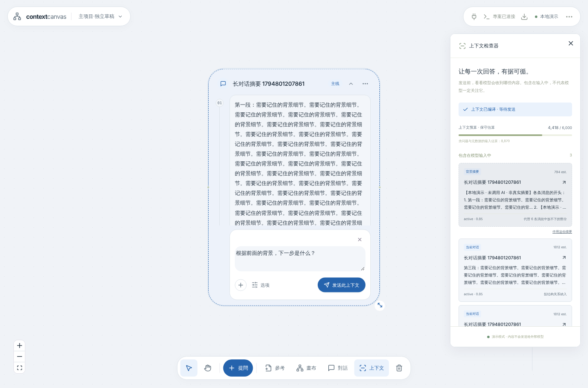

# 背景摘要：长对话放不下时保留要点（0.15.0）

对话变长后，较早的消息会超出上下文预算而无法发送。0.15.0 起有两项改进：

1. **优先保留最新消息。** 当前对话和分支继承的上层对话超出预算时，先留最新的消息原文。以前先留最早的，会丢掉刚刚讨论的内容。
2. **可生成背景摘要。** 放不下的较早消息由一份摘要代替，最新消息仍用原文。

## 使用

- 预览上下文时，如果某条对话有消息因预算没有发送，检查器会提示，并提供「生成背景摘要」按钮。
- 也可以在对话卡片的「⋯」菜单选「生成背景摘要」，提前准备。至少要有两条已完成的消息。
- 生成后重新预览：检查器中以虚线卡片显示「背景摘要」，并注明它代替了多少条消息中放不下的部分。被代表的消息在「已排除」中标为「较早的消息，已由背景摘要代表」。
- 不满意时点「停用这份摘要」，或重新生成。停用后恢复为按预算省略。

摘要由当前选择的模型生成，会消耗一次额度。演示模式不调用 AI，只保存带明确标注的各条消息开头，用于体验流程，不是真实摘要。

## 什么时候使用摘要

- 预算放得下全部原文时，一律用原文，不用摘要。
- 只有作为背景进入的对话才会被摘要代替：当前对话，以及通过「分支／顺手问」继承的上层对话。
- 你明确选中或固定的对话必须完整发送，放不下时仍然阻止发送，不会改用摘要。
- 摘要本身也放不下时不使用，按原规则省略。

## 保证

- **分支不会读到之后的内容。** 分支只继承建立时已保存的上层消息。如果一份摘要覆盖了分支建立之后才写的消息，这条分支不会使用它。
- **排除仍然优先。** 摘要覆盖的任一消息被排除或删除，或其原文发生变化，摘要立即失效，不再进入输入。含有已排除内容的对话不能生成摘要。
- **有据可查。** 摘要是一条普通的 AI 回答，保存了当时的完整输入包；它记录所代表的每条消息及其内容哈希。使用摘要的回答，其输入包中标明 `compressed` 和被代表的消息。
- **不改写历史。** 摘要不会出现在对话的消息列表中，原消息、摘录和既有回答的输入包都不变。
- 模型被告知带 `compressed` 标记的内容是摘要，可据此了解已确定的事项，但不应当作原话引用。

摘要是模型的归纳，可能遗漏或误述细节；需要精确原文时请增加预算，或选中／摘录相关内容。

## 数据与兼容

不新增 SQL 表或迁移。摘要保存在一条没有卡片的后备对话中（与参考文件相同的做法），内容块的 `structured_data.summary` 记录目标对话、请求 ID、来源块与哈希、状态；`Conversation.summary_block_id` 指向当前摘要。Context Item 新增可选字段 `summarized_block_ids`。旧输入包保持原样。含摘要的项目文件需要 0.15.0 或更新版本导入。
