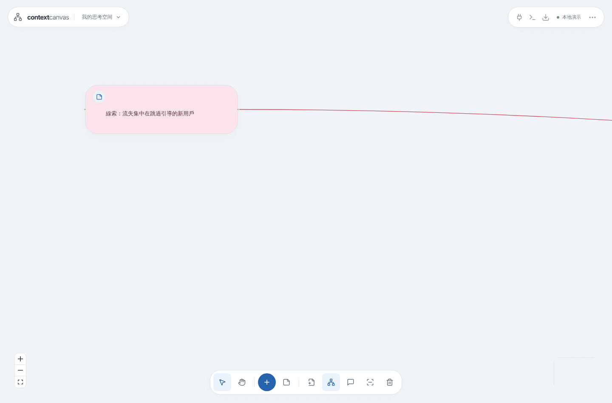
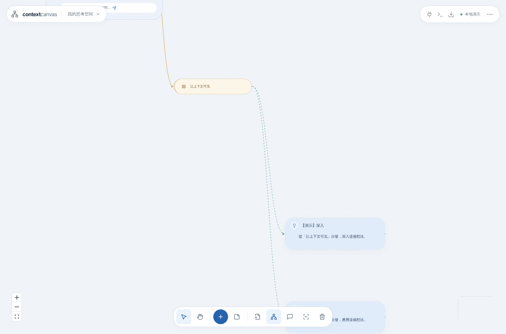

# 筆記、連結與腦力激盪（0.16.0）

畫布是人腦與 AI 合作整理想法的地方：先把零散的線索記下來，再用連結表達它們之間的關係，最後請 AI 統籌、分析或延伸。三個工具各負責一步。

## 筆記：只記錄，不回應

- 底部工具列的「筆記」圖示，或在畫布空白處右鍵選「在這裡新增筆記」。
- 寫下內容，選顏色，按 Enter 保存（Shift+Enter 換行）。筆記不會向 AI 提問，也不會產生回答。
- 卡片選單「編輯筆記」可修改文字或顏色。舊版本會保留，從舊文字摘錄的片段和已封存的回答輸入都不受影響。
- 「以此提問」會開一段新對話，並把這張筆記選為上下文。
- 筆記平常不會進入任何對話的上下文；只有你選中、固定，或用連結接到對話時才會進入。排除仍然優先。

## 連結：表達想法之間的關係

1. 在卡片選單選「連結到…」，畫面上方出現提示。
2. 點另一張卡片，選擇關係：支持、反對、補充、例子、依賴、替代、相關、取代。按 Esc 取消。
3. 線上會標出關係名稱，並依關係上色。點線可以改關係或移除連結。

連結會影響 AI 收到的內容：與對話直接相連的卡片會進入該對話的上下文，並註明關係。例如一張筆記「反對」這段對話，模型會知道它是反方論點並據此回答，可在上下文檢查器確認。一對卡片之間只保留一條連結，再連一次會改成新的關係。「取代」會把較舊的一方標為歷史內容。目前只傳遞直接相連的一層。

## 腦力激盪：從一段內容延伸出方向

1. 在任何回答、筆記或參考文件中選取一段文字，按選取工具列的燈泡；或在卡片選單選「腦力激盪」。
2. 選擇要幾個方向：3、5 或 8。
3. AI 會參考這段文字所在的對話脈絡，提出性質不同的方向，例如深入、質疑、應用、連結、替代。勾選想要的，按「加入 N 張」。
4. 勾選的方向會成為藍色虛線框的方向卡，以虛線連回來源，畫面會自動對準它們。沒勾選的不會出現在畫布上。
5. 方向卡選單「以此提問」會開新對話，並預先填好這個方向的問題，按 Enter 就能展開。

方向卡由 AI 產生並標示來源，平常不會自動進入其他對話的上下文。每次腦力激盪都是一次封存的模型呼叫，會消耗額度，並保留完整的輸入記錄。示範模式只會產生標示「演示」的固定方向，不是真實結果。

## 資料與相容

不新增 SQL 表。筆記沿用參考文件的做法：一段沒有卡片的後備對話中的人類訊息，內容區塊以 `structured_data.note` 記錄種類、顏色、版本與方向卡來源。連結是使用者建立的已確認語意邊。方向卡與來源之間是結構邊 `generated_from`。詳見[資料遷移](migrations.md)。含這些內容的專案檔需 0.16.0 或更新版本匯入。

## 尚未驗證

只在示範模式與替身模型下測試。真實模型產生的方向品質，以及連結關係是否確實改善回答，需要實際使用或執行 `pnpm eval:context` 才能判斷。
