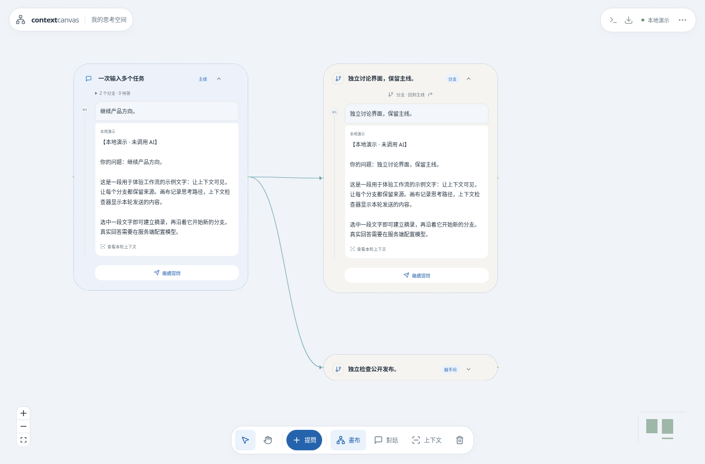

# 主线、分叉和摘录汇合（0.6.0）

## 阅读

每条对话有独立圆角区域、标题、顺序线和末尾输入入口，同一高度的对话分别沿各自的线阅读。标题旁箭头折叠／展开，位置及折叠状态保存。折叠后再展开保留本次页面中的草稿。Pick 从原文选区末端绘制弧线；滚动时跟随来源位置，来源离开阅读区域时端点限制在阅读区域边缘。定位仍依赖准确的 block 和选区。

## 输入分叉

1. 写主线问题；只问分支时可留空。
2. 输入框左下角「＋」添加「分支 /fork」或「顺手问 /btw」。也可在主输入末尾另起一行输入命令，再按 Enter；组合输入不会触发转换。
3. 每段写一个问题，可切换方式或移除，最多八段；填入或移除空白段后点「分别发送」。
4. 每个问题独立回答、停止、重试和追问；主线生成中只发送新增分支。主线的分支索引显示待答数量并可定位。

两种入口均创建可持续对话，保留不同任务标记；顺手问不会自动把回答合并回主线。它们使用当前模型／思考深度，可能同时消耗额度。分支固定继承父对话已经保存的背景、祖先背景与原始摘录，不读到后续主线或兄弟对话。同批的新主线问题不会自动成为其他任务的共享指示；共用约束请先保存在主线或写入各问题。较长背景按预算编译，可在检查器查看实际包含／省略的内容。

分支准备以事务创建并使用稳定请求 ID，重复请求不会多建。初始问题存入本地分支记录，刷新后尚未生成的任务也可继续发送。未提交的编辑草稿仍是本次页面状态；安装更新会检查这些草稿及正在准备／执行的任务。

## 收集与汇合

先摘录第一段，打开摘录卡点「收集」。在任意对话选中文字后「加入汇合点」，可持续收集，顶部「完成」退出。每个汇合点最多 200 处。

胶囊显示名称与数量，选中才展开来源。点击原文回到来源；「−」移出该段，不删除原始记录和历史引用。移出的附加摘录恢复为独立卡片。最初的摘录也能移出，其原文记录作为稳定锚点保留，当前上下文只使用剩余片段。最后一段不可单独移出，可删除整个汇合点；回收桶支持还原。

「延伸提问」使用当前来源。来源改变只影响下一轮，历史输入包、哈希和回答引用保持不变。选中／固定的汇合点及汇合分支的来源逐条检查预算，不能完整容纳时阻止发送。排除和删除按原有保守策略阻止来源块及派生回答重新进入输入。

## 数据和兼容

不新增 SQL 表或迁移。可选字段 `Conversation.fork_origin` 保存父对话、截止 turn、模式、请求 ID、初始问题、冻结的 block／excerpt ID；结构边 `continue_from` 标记父子关系。可选字段 `Excerpt.collection_source_ids` 保存非空、去重的原始摘录列表，成员不能嵌套汇合点。锚点原文属性保持不变，成员节点在画布中集中显示，canonical entities 和 `excerpt_from` 来源边仍保存。

Compiler 将列表展开为真实摘录条目，逐条保留来源、选区、哈希、生命周期与排除控制。坐标、线条、折叠和集中显示都不决定上下文。项目导入校验来源引用、分支循环、请求 ID 和成员列表。旧备份不含新字段时保持原样；含新字段的项目需 0.6.0 或更新版本，旧版本会拒绝不认识的字段。

回归覆盖背景冻结、兄弟隔离、嵌套分支、事务回滚／重复请求、跨对话收集、移出锚点、预算／排除、不可改写的历史输入、重启及备份引用。浏览器还检查主线生成时的分支、原生编辑器身份、标点／组合输入和手机触控。模拟组合输入不是 Windows 原生 IME 或 iOS 实机验证。
