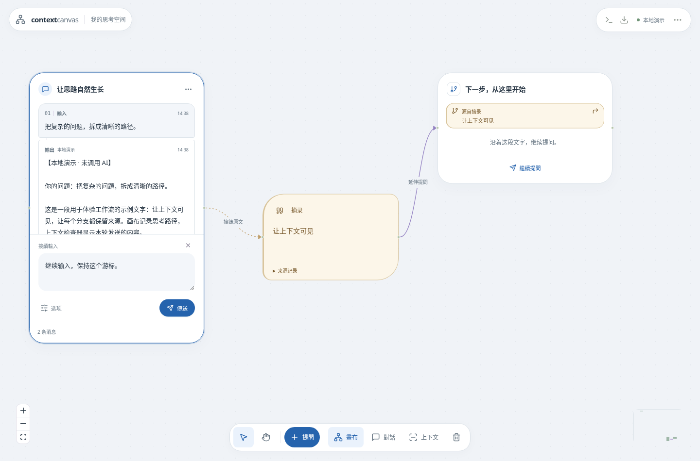
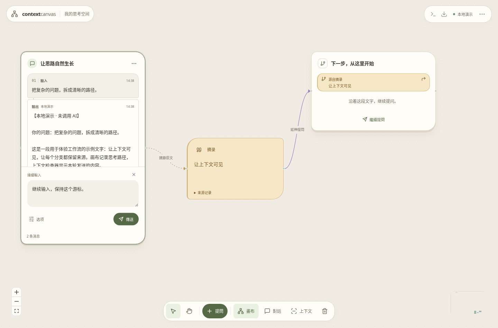
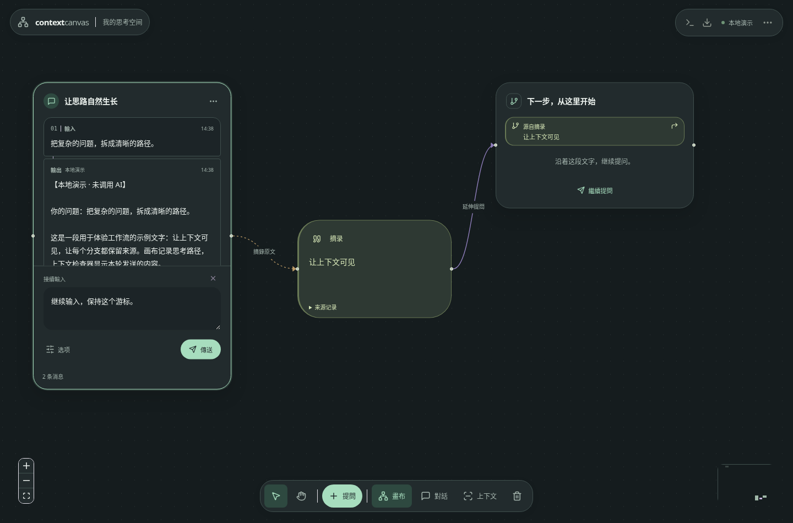

# 给画布换一种形状（0.5.5）

右上角「⋯」→「画布外观」，点击方案即可在现有画布预览；点击「完成」或按 Esc 返回。选择保存在此浏览器，无需重启，也不改变对话和来源记录。默认使用 Arc，其他方案随时可切换。

| 方案           | 视觉与使用感                                                             |
| -------------- | ------------------------------------------------------------------------ |
| **Arc 弧面**   | 冷白、蓝色重点、大圆角；小型摘录用不对称弧形轮廓连接对话。适合日常整理。 |
| **Paper 纸感** | 暖纸、细边框、轻叠页；问答与摘录带有不同纸色。适合长文阅读。             |
| **Ink 墨色**   | 石墨画布、薄描边、薄荷色重点；摘录为浅橄榄色文字的圆弧卡。适合沉浸阅读。 |

## 相同的简洁操作

- 对话顶部合并图标、标题和「⋯」，分支改用分支图标辨识。空白对话不再显示多段使用说明，也不预留一大块空白阅读区。
- 摘录节点比对话窄，采用独立弧形、底色与引文图标。自动生成的摘录标题不再重复显示正文；自定义标题仍显示。「来源记录」可展开查看原文范围、block ID 与内容 hash。
- 每张卡片底部的固定／排除／选择工具移入卡片「⋯」与右键菜单。鼠标悬停或键盘进入卡片时显示更多入口；触屏上保留可点按的菜单与摘录操作。
- 输入区优先显示文字与传送；点「选项」调整预算或预览上下文。预览后仍可检查来源并发送原输入包。
- 上方「⋯」统一提供外观、备份与帮助；原有模型、本地任务、版本更新入口保留。
- 连接线改用平滑曲线。线型、来源方向、摘录快照和分支关系继续使用原有领域记录。

三版共用同一套交互。切换仅改变外观，不重排节点、不重建输入框、不改变每次回答的封存上下文。多对话并行、独立停止与重试仍可使用。外观是当前浏览器的偏好，不随画布备份跨设备同步。

## 实际界面

以下截图使用测试环境中的合成 Demo 对话，不包含个人画布或登录资料。

### Arc 弧面

### Paper 纸感

### Ink 墨色

