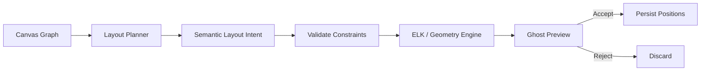

## Canvas UX、語意縮放與 Layout 規範
最危險的 UX 失敗模式是：

> 把線性聊天的「一直往下滾」問題，換成 Canvas 的「到處都是卡片和線」問題。

所以 Canvas 的核心設計不是 unlimited space，而是 **progressive disclosure**。

### Semantic Zoom

同一 Node 在不同 zoom level 不顯示相同內容。

```text
Zoom Far

┌─────────────────┐
│ Context Compiler│
│ ● confirmed     │
└─────────────────┘
```

```text
Zoom Medium

┌────────────────────────────┐
│ Context Compiler           │
│ 將 Graph 編譯成可控 context│
│                            │
│ Resolve → Retrieve → Rank  │
│ 18 turns · 3 branches      │
└────────────────────────────┘
```

```text
Zoom Near

┌──────────────────────────────┐
│ Context Compiler             │
│                              │
│ User: Context 如何排序？     │
│                              │
│ AI: 先明確選取，再……         │
│                              │
│ [Excerpt] [Branch] [Pin]     │
└──────────────────────────────┘
```

```text
Focus Layer

Canvas › Context Architecture › Context Compiler

User
──────────────────────────────
Context 如何排序？

Assistant
──────────────────────────────
完整 Markdown 回答……
完整 Markdown 回答……
完整 Markdown 回答……
```

建議定義四個 level：

| Level | 用途 | 顯示 |
|---|---|---|
| L0 Overview | 看整體圖 | title、state、branch count |
| L1 Summary | 看區塊意義 | AI/user summary、keywords |
| L2 Conversation | 看 turns | condensed messages |
| L3 Focus | 深讀 | 完整 content blocks |

長對話因此應該是：

> **同一個邏輯 Graph，不同視覺層。**

而不是把 30 turns 全展開成一張 6000px 高的卡片，也不是每次點進去就跳到完全無關的另一個 Canvas。

### Node Representation 與 Content 分離

Node 應同時有：

```text
Canonical Content
       │
       ├── Representation L0
       ├── Representation L1
       └── Representation L2
```

Representation 是 view cache，可以重新生成。

Content 是 source of truth。

例如：

```json
{
  "content_ref": "conv_context_compiler",
  "representation": {
    "l0": {
      "title": "Context Compiler",
      "badge": "confirmed"
    },
    "l1": {
      "title": "Context Compiler",
      "summary": "把視覺 Graph 編譯成模型可消化的 bounded context。",
      "key_points": [
        "Resolve",
        "Retrieve",
        "Rank",
        "Compress",
        "Conflict"
      ]
    },
    "l2": {
      "show_recent_turns": 4
    }
  }
}
```

AI 可以生成 representation，但使用者應能：

```text
Regenerate
Edit
Pin representation
Restore source-derived version
```

### Excerpt 操作

文字 selection 是本產品極重要的 interaction。

建議 selection toolbar：

```text
AI 回答：
「真正的核心不是 Canvas，而是讓人知道
 AI 此刻究竟使用了哪些 Context。」

           ┌──────────────────────────────┐
選取文字 → │ Branch │ Pin │ Link │ Quote │
           └──────────────────────────────┘
```

`Branch` 操作應原子性執行：

```text
create Excerpt
      ↓
create Excerpt Node
      ↓
create excerpt_from edge
      ↓
create new Conversation
      ↓
create branch_from edge
      ↓
focus composer
```

不是：

```text
copy text
→ paste into new chat
```

因為後者會失去 provenance。

### Image Region Addressing

圖片也應可像文字一樣被「選取→開分支」。

```text
┌────────────────────────────────────┐
│                                    │
│  UI Screenshot                     │
│                                    │
│        ┌─────────────────┐         │
│        │ selected region │◄────────┼── discussion target
│        └─────────────────┘         │
│                                    │
└────────────────────────────────────┘
```

W3C Media Fragments 對 spatial dimension 使用矩形 `xywh`，並支援 pixel / percentage 表達，因此 MVP 用矩形 image selector 是合理且可互通的基礎抽象。

第一版不需要 polygon/freehand mask。

### Progressive Disclosure

Canvas 應預設讓「歷史存在，但不全展開」。

例如：

```text
                  ┌ UX Research ─────────────┐
                  │ 17 turns · 4 branches    │
                  └──────────────────────────┘
                              │
                              │
┌ Product Thesis ─┐      ┌ Context Engine ─────┐
│ 8 turns         │─────▶│ 23 turns · 6 branch │
└─────────────────┘      └──────────────────────┘
                              │
                              ▼
                  ┌ Agent Architecture ────────┐
                  │ 11 turns                   │
                  └────────────────────────────┘
```

點 Context Engine：

```text
Context Engine
├── Context Set
├── Ranking
├── Conflict
├── Inspector
└── Token Budget
```

再點 Ranking 才出完整 conversation。

### Context Inspector

Context Inspector 是產品最應投入品質的 UI 之一。

建議右側固定 panel：

```text
┌──────────────── Canvas ────────────────────────┬──────── Context Inspector ───────┐
│                                               │                                  │
│     ┌ Product Thesis ┐                        │ THIS RESPONSE                    │
│     │ ██████████████ │◄──────────────┐        │ pkg_042                          │
│     └────────────────┘               │        │                                  │
│                                      │        │ SELECTED                         │
│            ┌ Context Set ┐           │        │ ● Context selection 原則  1.00  │
│            │ ███████████ │◄──────────┼────────│                                  │
│            └─────────────┘           │        │ PINNED                           │
│                   │                  │        │ ● Product principle       0.98  │
│                   ▼                  │        │                                  │
│            ┌ Current Question ┐      │        │ RETRIEVED                        │
│            │ How to rank?     │      │        │ ◐ Ranking notes           0.76  │
│            └──────────────────┘      │        │ ◐ Old summary             0.71  │
│                                      │        │                                  │
│     ┌ Old Neo4j Plan ┐               │        │ EXCLUDED                         │
│     │ superseded     │               │        │ × Old Neo4j plan                │
│     └────────────────┘               │        │                                  │
│                                               │ CONFLICTS                        │
│                                               │ ! SQLite supersedes Neo4j        │
│                                               │                                  │
│                                               │ Tokens 8.4k / 24k target         │
└───────────────────────────────────────────────┴──────────────────────────────────┘
```

Interaction 規範：

- Hover Inspector item → Canvas node highlight。
- Click item → viewport focus 該 node。
- Click `× excluded` → 看排除原因。
- Click score → 顯示 explanation，不顯示神秘單一 AI score。
- Pin / Unpin 應立即影響下一次 Context Set。
- 對「模型實際使用」與「compiler 準備給模型」要語義精確：應寫 **Included in model input**，不要宣稱「模型一定注意到」。長 context research 正提醒了「被放進 prompt」與「模型真正有效利用」並不相等。

### Layout 協助策略

React Flow 的官方範例展示了 dagre、d3-hierarchy、ELK 等自動 layout 以及 expand/collapse、node animation 等模式，因此幾何計算應交給 deterministic layout engine；LLM 應提供高層「為什麼這些東西應該放一起」的 semantic intent。

**Manual**

```text
AI:
- 不移動 node
- 不建立 group
- 只可顯示 align/snapping helper
```

適合使用者已形成個人 spatial memory 時。

**Assist — 建議預設**

```text
AI proposal
    ↓
Ghost Layout Preview
    ↓
Accept / Reject / Apply Selection
    ↓
deterministic geometry
```

例如：

```text
Before

A           C
     B

          D


Suggested preview

[Context Architecture]
A ─ B ─ C

[Implementation]
D
```

使用者確認後才移動。

**Auto**

僅應在使用者主動切換後啟用。

Hard rules：

```text
pinned node       → never move
locked group      → never restructure
manual cluster    → preserve unless explicitly allowed
large relocation  → preview or undo checkpoint
new node          → may auto-place
local overlap     → may auto-resolve
```

**Layout Intent 格式**

```json
{
  "id": "layout_intent_018",
  "workspace_id": "ws_01",
  "mode_assumption": "assist",
  "scope_node_ids": [
    "node_context_set",
    "node_compiler",
    "node_inspector"
  ],
  "operations": [
    {
      "op": "create_cluster",
      "node_ids": [
        "node_context_set",
        "node_compiler",
        "node_inspector"
      ],
      "label": "Context Architecture",
      "reason": "三個節點屬於同一資料流",
      "confidence": 0.93
    },
    {
      "op": "arrange_flow",
      "node_ids": [
        "node_context_set",
        "node_compiler",
        "node_inspector"
      ],
      "direction": "left_to_right",
      "reason": "符合 Context Set → Compiler → Inspector 的閱讀順序",
      "confidence": 0.96
    }
  ],
  "constraints": {
    "pinned_node_ids": [
      "node_context_set"
    ],
    "locked_group_ids": [],
    "minimum_gap": 48,
    "preserve_relative_order": true
  },
  "requires_confirmation": true
}
```

Layout pipeline：



---
